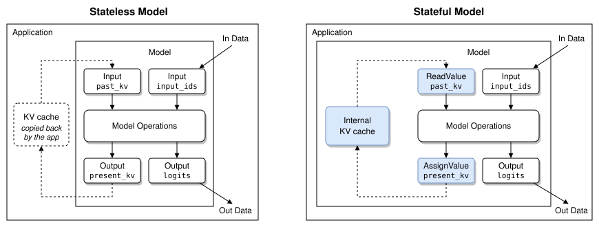

# Support Dynamic Language Models on NPUs via WebNN

## Authors
- [Wei Wang](mailto:wei4.wang@intel.com), [Wanming Lin](mailto:wanming.lin@intel.com) (Intel)

## Participate
- [Support flexible input sizes #883](https://github.com/webmachinelearning/webnn/issues/883)
- [Composite operators / subgraphs #907](https://github.com/webmachinelearning/webnn/issues/907)

## Table of contents
1. [Introduction](#introduction)
2. [Goals](#goals)
3. [Non-goals](#non-goals)
4. [Use Cases](#use-cases)
5. [Challenges and Requirements](#challenges-and-requirements)
6. [Dependencies on Non-stable Features](#dependencies-on-non-stable-features)
7. [Proposed API](#proposed-api)
8. [Design Discussion](#design-discussion)
9. [Implementation Experience: OpenVINO on Intel NPU](#implementation-experience-openvino-on-intel-npu)
10. [Considered Alternatives](#considered-alternatives)
11. [Privacy & Security Considerations](#privacy--security-considerations)
12. [Future Considerations](#future-considerations)
13. [Open Questions](#open-questions)
14. [References & Acknowledgements](#references--acknowledgements)

## Introduction
WebNN today targets models whose shapes are fully resolved at [`MLGraphBuilder.build()`](https://www.w3.org/TR/webnn/#api-mlgraphbuilder-build) time and whose execution is stateless: the outputs of each [`MLContext.dispatch()`](https://www.w3.org/TR/webnn/#api-mlcontext-dispatch) depend only on the input tensors bound to that call, and nothing is carried over from one dispatch to the next. A language model (LM) violates both assumptions. First, its input shapes cannot be resolved at build time: each request begins with a prompt of arbitrary length and then emits one token at a time, so the sequence length of the input is only known at dispatch. Second, its execution is not stateless: each step depends on a key/value (KV) cache that grew during every previous step, so every dispatch needs what the previous dispatches left behind.

Based on our proof of concept, this explainer describes what it takes to run an LM efficiently on an NPU through WebNN. It starts from the two ways a page uses an LM, [single-turn generation](#single-turn-generation) and [multi-turn chat](#multi-turn-chat). From them it derives four challenges. Besides the two above, there are LM-specific operators that frameworks have to emulate with primitive operators, and a usage intent that a compile-ahead accelerator needs before it compiles but that the graph does not express. Each challenge becomes a requirement on WebNN, and the four requirements are met in two ways:

- **Two are met by features already under discussion.** Flexible input shapes, from the [Dynamic Shape explainer](https://github.com/webmachinelearning/webnn/blob/main/dynamic-shape-explainer.md), and composite operators and subgraphs, from [webmachinelearning/webnn#907](https://github.com/webmachinelearning/webnn/issues/907). This explainer adopts them as [dependencies](#dependencies-on-non-stable-features) and does not redefine them.
- **Two are met by additions this explainer proposes.** A [stateful model](#stateful-model) keeps the KV cache inside the model across dispatches: the page marks which graph inputs and outputs carry the cache, and the underlying implementation keeps it as internal state. [Build-time metadata](#build-time-metadata) lets the page tell the underlying implementation how it intends to drive the model.

These four mechanisms only describe the model; they do not say how to run it. Each underlying implementation decides that for itself, so the same graph runs on any of them. [Implementation Experience](#implementation-experience-openvino-on-intel-npu) shows one example from our proof of concept on Intel NPU through OpenVINO, which relies on three optimizations: static decomposition, KV cache management, and pattern matching and fusion.

The figure below shows, for each challenge, the WebNN mechanism that meets it and the OpenVINO optimization that implements it on the NPU:


## Goals
- Run a dynamic LM end to end on an NPU through WebNN across an arbitrary prompt length and as many decode steps as the model's context length allows, **without rebuilding the graph**.

- Express the operators that every modern LM contains — scaled dot-product attention, rotary position embedding, RMS normalization, and block-quantized matrix multiplication — in a **standard way**, so every underlying implementation can reliably recognize them and apply its optimized implementation, instead of each framework emitting its own decomposition.

- Keep the KV cache **resident on the device** across dispatches, and across the turns of a conversation, so the per-step cost tracks the compute the model actually does rather than the size of the cache.

- Let the page state **how it will drive the model**, such as the longest prompt and the reply length it plans for, so an underlying implementation for a compile-ahead accelerator can size its compiled models and its cache before the first dispatch instead of guessing from the shapes it observes later.

- Keep the model **portable**: the page only describes which dimensions change, which tensors are the KV cache, and how it intends to use them, and each underlying implementation chooses its own strategy. A graph written for the NPU must still run on GPU and CPU.

- Make the NPU strategy — static model variants, prefill chunking, in-place cache update, fusion — an **implementation detail** that is observable in performance and resource limits, but not in the results a graph computes.

## Non-goals
- **We do not define a model format, a tokenizer, or a sampling API.** Tokenization, sampling, beam search, and chat templating stay in the framework or the application. WebNN's surface ends at the graph.

- **We do not resolve shapes from tensor data.** This explainer inherits the boundary drawn in the [Dynamic Shape explainer](https://github.com/webmachinelearning/webnn/blob/main/dynamic-shape-explainer.md): shapes are derived by algebra from input shapes and build-time constants. A sequence length that depends on the *values* a model produced (for example, trimming at a stop token inside the graph) is out of scope.

- **We do not specify a cache eviction or paging policy.** Sliding windows, attention sinks, and paged attention are model- and application-level decisions. The API provides a KV cache with explicit shape and explicit update; it does not pick a policy.

- **We do not expose NPU-specific controls.** There is no API to select a model variant, a chunk length, or a fusion pattern. Those are chosen by the underlying implementation.

- **We do not define flexible input shapes or composite operators.** Both are the subject of separate proposals that are still under discussion. This explainer depends on them and states only what an LM needs from them; see [Dependencies on Non-stable Features](#dependencies-on-non-stable-features).

## Use Cases
A page drives an LM in one of two patterns. Both run the same graph through the same two phases — a *prefill* that processes the prompt in one dispatch, then a *decode* that emits one token per dispatch — and both build up a KV cache as they go. They differ in what happens to that cache between requests.

### Single-turn generation
The page submits one self-contained prompt and generates one reply: summarizing an article, rewriting a selected paragraph, translating a message, or filling in a form field from free text. Each request is independent of the ones before it:

1. **Prefill.** The prompt is processed in one dispatch. Its length is different for every request, from a short instruction to a whole article.
2. **Decode.** The reply is generated one token per dispatch, each step attending over the prompt and every token generated so far, until an end token or a length limit.
3. **Reset.** The cache is discarded before the next request, so one request never sees another's text.

The page needs a graph that accepts any prompt length without being rebuilt, decode steps whose cost does not grow with the cache, and a reset that does not reallocate or recompile anything. How long the prompt and the reply are depends on the task: a summary is much shorter than the article it summarizes, while a reply drafted from a one-line instruction is much longer than the instruction. Only the page knows which kind of task it runs.

### Multi-turn chat
The page runs a conversation: a chat assistant, a writing helper, or a tutor embedded in the page. Each turn adds a user message and a reply on top of the earlier turns, and the model has to see the whole conversation:

1. **First turn.** Prefill and decode run as in single-turn generation.
2. **Later turns.** If the cache is kept, the page prefills only the new message, on top of the cache left by the previous turn, and then decodes. The time to the first token follows the length of the new message, not of the conversation.
3. **New conversation.** The cache is reset only when the user starts over.

If the cache is not kept between turns, the page has to resubmit the whole history every turn. Each turn then recomputes everything before it, and the time to the first token grows as the conversation goes on. So in addition to what single-turn generation needs, chat needs the cache to persist across turns as well as across decode steps, a prefill that starts from a non-empty cache, and a context capacity large enough for the whole conversation.

## Challenges and Requirements
Both use cases run into the same four challenges on WebNN as it is today. The first three concern how the model is computed; the fourth concerns what the underlying implementation needs to know about how the page will use it. Each challenge ends with the requirement it places on WebNN.

### Dynamic prompt length
Every request starts with a prefill over the whole prompt, and the prompt length is whatever the user typed; in a chat, the length of each new message varies the same way. With static shapes a framework can only rebuild the graph per length, pre-build a family of graphs, or pad every prompt to a fixed maximum. This is the general flexible-input-size problem, and it is analyzed in full — use cases, existing workarounds, and their costs — in the [Dynamic Shape explainer](https://github.com/webmachinelearning/webnn/blob/main/dynamic-shape-explainer.md). What matters here is only that an LM hits it on every single request.

**Requirement:** one compiled graph must accept a sequence length that is only known at dispatch.

### LM-specific operators
The repeated block of a modern decoder is small and remarkably uniform across model families:

- **Attention** — scaled dot-product attention with causal masking and grouped-query key/value heads.
- **RoPE** — rotary position embedding applied to queries and keys before attention.
- **Norm** — RMS normalization (and its `layerNormalization` relative) before each sublayer.
- **MatMulNBits** — matrix multiplication against n-bit group-quantized weights, which is how a model of practical size fits in device memory at all.

WebNN does not expose these directly today, so a framework lowers each one into a chain of primitive operators. For example, MatMulNBits becomes an explicit dequantization — gather the scales and zero points, unpack the n-bit values from the packed bytes, widen them, subtract the zero points, multiply by the scales, then `matmul` on the widened weights. This lowering is lossy in three distinct ways:

- **It materializes what should never exist.** The dequantized weight matrix is many times the size of the packed one, and it is produced only to be consumed immediately. On a memory-constrained NPU this can be the difference between a model that fits and one that does not. The same applies to attention's intermediate score matrix, which is quadratic in sequence length.
- **It hides the intent.** An underlying implementation with a hand-tuned fused attention or fused dequantizing GEMM kernel now has to *recover* the pattern by matching a subgraph. Pattern matching is brittle: a transposition folded differently, an extra `reshape`, a `cast` in a different place, and the match fails silently — leaving the graph on the slow path with no diagnostic.
- **It is not portable.** Each framework lowers slightly differently, so "does this model run fast on WebNN" becomes a question about which framework emitted the graph, not about the model.

**Requirement:** LM computation must be expressible at the level it is defined, in a form every underlying implementation recognizes, so that its intent reaches the kernel.

### Growing decode KV cache
After prefill, decode emits one token per step. Each step computes keys and values for a single position and attends over every position seen so far, so the cache grows by one entry per step, per layer. For a stateless model, that cache is an input and an output of every dispatch. Three costs follow:

- **Transfer.** The compute of a single decode step is tiny; the copy is proportional to the whole conversation, so the step time grows linearly with context length for reasons that have nothing to do with the model.
- **Allocation and concatenation.** `newCache = concat(oldCache, newEntry)` allocates a fresh buffer every step and copies the old contents into it — again linear in the context, and it doubles peak memory at the moment of the copy.
- **Shape churn.** The cache length changes on every step, so an underlying implementation that specializes per shape has to re-specialize each time.

A stateless API also leaves the page no way to say *this buffer is the same buffer as last time*, which is precisely the fact an underlying implementation needs in order to keep it in device memory and update it in place. In a multi-turn chat the problem extends past a single reply: the cache has to survive from one turn to the next as well.

**Requirement:** the KV cache must persist across dispatches and across turns, and be updatable without crossing the API boundary.

### Usage intent on compile-ahead accelerators
The first three challenges are about describing the *computation*. They do not describe how the page intends to *use* it, and on a compile-ahead accelerator that intent is exactly what the underlying implementation needs in order to choose a strategy. An underlying implementation for such an accelerator may make some of its decisions when the graph is compiled. OpenVINO on the Intel NPU, for example, decides then the longest prompt it compiles a prefill for, how much KV capacity it reserves, and which model variants it builds, and keeps them fixed for the life of the graph (see [Static decomposition](#static-decomposition)).

A graph with a `'seq_len'` dimension says the length varies; it does not say that the page will run one 2k-token prefill followed by hundreds of single-token decodes, or that the conversation will never exceed 4k tokens. The two use cases also pull in different directions: a summarizer submits long prompts and expects short replies, while a chat submits short messages that add up to a long context. Today the underlying implementation has to guess from the shapes it happens to observe, and it observes them only after it has compiled. A guess that is too small fails a long prompt or runs out of cache partway through a conversation. A guess that is too large wastes memory and compile time on a context the page never reaches.

**Requirement:** the page must be able to tell the underlying implementation how it will drive the graph at build time.

### Summary
The table maps each challenge to its requirement and to the WebNN mechanism that meets it:

| Challenge | Requirement on WebNN | WebNN Mechanism | Status |
| --- | --- | --- | --- |
| Dynamic prompt length | One compiled graph accepts a sequence length known only at dispatch | [Flexible input shapes](#flexible-input-shapes) | Dependency |
| LM-specific operators | LM computation is conveyed in a standard form | [Composite operators and subgraphs](#composite-operators-and-subgraphs) | Dependency |
| Growing decode KV cache | The cache persists across dispatches and turns without crossing the API boundary | [Stateful model](#stateful-model) | Proposed here |
| Usage intent on compile-ahead accelerators | The page conveys how it will drive the graph at build time | [Build-time metadata](#build-time-metadata) | Proposed here |

The first two requirements are already addressed by other proposals, so we mark them as *Dependency*; the next section describes what an LM needs from each. The other two are new in this explainer, so we mark them as *Proposed here*; [Proposed API](#proposed-api) defines them.

## Dependencies on Non-stable Features
Flexible input shapes and subgraphs are both under discussion and this explainer adopts their current direction rather than defining its own version.

### Flexible input shapes
The first requirement is met by the dimension model from the [Dynamic Shape explainer](https://github.com/webmachinelearning/webnn/blob/main/dynamic-shape-explainer.md), adopted here unchanged. In that model, a dimension is either a static integer or a **named dynamic** dimension, and dimensions that share a name resolve to the same value at dispatch. See that document for the full API surface and the design rationale.

For an LM, three named dynamic dimensions cover every shape that changes at runtime, so the same compiled graph serves both phases. `'seq_len'` is what tells the phases apart: the prompt length at prefill, 1 at decode. `'past_len'`, the length of the KV cache, is 0 at the first prefill and grows by one with every decode step; in a multi-turn chat it is also non-zero at the prefill of every later turn. `'total_len'` is always `'past_len'` plus `'seq_len'`, so it changes on every dispatch, within decode as well as between the phases:

```js
// 'seq_len'    — tokens in this dispatch: the prompt length at prefill, 1 at decode.
// 'past_len'   — tokens already in the KV cache: 0 at the first prefill, +1 per decode step.
// 'total_len'  — past_len + seq_len: everything attention sees.
const inputIds = builder.input('input_ids',
    {dataType: 'int32', shape: [1, 'seq_len']});
const positionIds = builder.input('position_ids',
    {dataType: 'int32', shape: [1, 'seq_len']});
const attentionMask = builder.input('attention_mask',
    {dataType: 'int32', shape: [1, 'total_len']});
```

Flexible input shapes let the page express that. How an NPU absorbs it without recompiling is left to the underlying implementation, as [Static decomposition](#static-decomposition) shows for OpenVINO.

### Composite operators and subgraphs
The second requirement is about expressing LM computation at a level where its intent survives from the model to the kernel. Today this relies on **implicit pattern matching**. WebNN has no built-in operator for attention, RoPE, or MatMulNBits, so:

1. The framework decomposes each high-level operation into primitive WebNN operators, choosing the specific decomposition it knows the underlying implementation can recognize.
2. The underlying implementation scans the graph, matches that subgraph, and fuses it back into a single optimized kernel.

This can reach good performance, but only when the framework and the underlying implementation agree on the pattern, and nothing in the API makes them agree. Each underlying implementation recognizes its own form: one expects the `transpose` before the `matmul` and another after it, one requires a `cast` in a specific position and another folds it away, one matches RoPE as slice/negate/concat and another as a gather of interleaved pairs. A framework therefore either targets one underlying implementation's patterns or maintains a separate lowering for each, while the page cannot even tell which underlying implementation it is running on.

**Subgraphs** address this by making the pattern explicit and standard. Instead of each underlying implementation deciding which decomposition it recognizes, a subgraph defines a standard composition of core operators that the page invokes as a single unit. Every underlying implementation can execute it correctly through its decomposition, and an underlying implementation with a fused kernel for it can use that kernel directly, without recovering the pattern from the surrounding graph. A framework then emits the same subgraph on every underlying implementation, so compatibility becomes a property of the standard rather than of the framework's knowledge of each underlying implementation.

For an LM, what matters is that the set covers the four operators listed in [LM-specific operators](#lm-specific-operators): attention with causal masking and grouped-query heads, RoPE, RMS normalization, and block-quantized matrix multiplication. The design is still under discussion; see [Composite operators / subgraphs (webmachinelearning/webnn#907)](https://github.com/webmachinelearning/webnn/issues/907) for the proposal and its open questions. Until it lands, frameworks keep emitting primitives, and underlying implementations keep matching patterns, as [Pattern matching and fusion](#pattern-matching-and-fusion) describes for OpenVINO.

## Proposed API
With shapes and operators covered by those proposals, two requirements remain: keeping the KV cache inside the model, and telling the underlying implementation how the page will drive the model. This explainer proposes one addition for each. Both are requested at build time through a new `MLBuildOptions` dictionary; the stateful model also adds `MLGraph.isStateful`, which reports whether the request was honored, and `MLContext.resetKVCache()`, which clears the cache between requests. Neither adds an operator, and a graph built without them behaves exactly as it does today.

### Stateful model
The stateful model meets the requirement that dynamic shapes alone cannot: a value that **persists across executions of the same graph** and stays inside the model, where the underlying implementation manages it. For an LM, that value is the KV cache, so throughout this explainer a *stateful* model is one that keeps its KV cache inside the model between executions. The figure below compares a stateless model with a stateful one:



A **stateless** model keeps nothing between runs. Everything a run produces is an output, and everything it needs is an input:

- **The application carries the cache.** To reach the next decode step, the KV cache leaves the model as an output, is held by the application, and comes back in as an input, so it crosses the API boundary twice on every step.
- **The cost follows the conversation, not the model.** The cache is transferred, and usually reallocated, on every step, so the overhead grows with the context length even though each decode step computes a single token.
- **The application manages the lifecycle.** It supplies the empty cache on the first run, swaps outputs into inputs between runs, and discards the cache when a conversation ends.

A **stateful** model replaces that input/output pair with internal read and write operations: `ReadValue` reads the KV cache at the start of a run, and `AssignValue` writes the updated cache at the end of it. The cache itself lives inside the model, persists between runs, and is never exposed as an input or an output:

- **The cache stays inside the model.** The underlying implementation decides where and in what form to keep it, so it can stay resident in device memory and be updated in place instead of crossing the API boundary on every step.
- **The application only passes real inputs and outputs.** It sends `input_ids`, `position_ids`, and `attention_mask`, and reads back `logits`; there are no KV cache tensors to allocate, copy, or swap.
- **The cache is not visible to the application.** Since the cache is neither an input nor an output, the application cannot read its contents. This costs nothing for the KV cache, which the application never needs to look at, and it is what lets the underlying implementation keep the cache in whatever form suits the device.

WebNN can express this without new operators. The graph is built exactly as a stateless one, with the cache as an ordinary input and the updated cache as an ordinary output. The cache stays in the graph because the underlying implementation needs the original graph to see how the cache is read and updated, and to convert each pair into state. It is also what lets the same graph run stateless when `isStateful` is false. The page then marks which input/output pairs carry the KV cache, and sets a flag that turns the stateful treatment on:

```webidl
dictionary MLKVCachePair {
  // Graph input that provides the KV cache to the graph.
  required DOMString input;
  // Graph output that stores the updated KV cache.
  required DOMString output;
};

dictionary MLBuildOptions {
  // When false (the default), the pairs are ignored and the graph is stateless.
  boolean useStateful = false;
  sequence<MLKVCachePair> kvCachePairs = [];
};

interface MLGraphBuilder {
  // The existing build() gains an optional options argument.
  Promise<MLGraph> build(MLNamedOperands outputs,
                         optional MLBuildOptions options = {});
};

partial interface MLGraph {
  // True if the underlying implementation manages the KV cache pairs.
  // False if the graph was built stateless, either because useStateful
  // was false or because the underlying implementation does not support
  // stateful for this model.
  readonly attribute boolean isStateful;
};

partial interface MLContext {
  // Reset every KV cache of the graph for a new request or conversation.
  // Does nothing when graph.isStateful is false.
  undefined resetKVCache(MLGraph graph);
};
```

The interfaces are:

- **`MLKVCachePair`** names one KV cache by the graph input and output that carry it. `input` provides the cache to the graph, and `output` stores the updated cache. How the two relate across dispatches is described in [Stateful model design](#stateful-model-design).

- **`MLBuildOptions.useStateful`** requests a stateful graph. When it is false, the default, `kvCachePairs` is ignored and the cache inputs and outputs remain ordinary bindings that the app supplies itself. When it is true, it is a request, not a guarantee; see [Fallback and isStateful](#fallback-and-isstateful).

- **`MLBuildOptions.kvCachePairs`** lists the KV cache pairs of the graph, typically one for the keys and one for the values of each layer. It is checked by [`MLGraphBuilder.build()`](https://www.w3.org/TR/webnn/#api-mlgraphbuilder-build) as described in [Build-time validation](#build-time-validation).

- **`MLGraph.isStateful`** reports what was actually built. It is true if the underlying implementation manages the KV cache pairs. It is false if `useStateful` was false, or if the underlying implementation does not support stateful models and the graph was built stateless instead. If it is false, the app binds the cache inputs and outputs and carries the cache between dispatches itself.

- **`MLContext.resetKVCache(graph)`** resets every KV cache of `graph` to its initial, empty value, for a new request or conversation, without rebuilding the graph or reallocating device memory. Like [`MLContext.dispatch()`](https://www.w3.org/TR/webnn/#api-mlcontext-dispatch), it is queued on the context's timeline, so it is ordered with the dispatches around it; see [Semantics](#semantics). It does nothing when `graph.isStateful` is false.

No interface returns a cache's contents or shape, so the KV cache is not readable from script. This is a privacy property as much as a performance one; see [Privacy & Security Considerations](#privacy--security-considerations).

### Build-time metadata
The stateful model tells the underlying implementation *what* to keep across dispatches. Metadata tells it *how* the page intends to drive the graph, which is what [Usage intent on compile-ahead accelerators](#usage-intent-on-compile-ahead-accelerators) requires. It is supplied once, at build time, because that is when an underlying implementation for a compile-ahead accelerator makes its decisions:

```webidl
// Build-time metadata: describes how the page will drive the graph.
dictionary MLModelMetadata {
  [EnforceRange] unsigned long maxPromptLength;
  [EnforceRange] unsigned long minResponseLength;
};

partial dictionary MLBuildOptions {
  MLModelMetadata metadata = {};
};
```

Metadata has a fixed set of members, defined by the specification. This explainer defines two, both general LM concepts that do not depend on the device:

| Member | Type | Meaning |
| --- | --- | --- |
| `maxPromptLength` | `unsigned long` | The longest prompt in tokens the page will prefill in one dispatch. |
| `minResponseLength` | `unsigned long` | The number of tokens the page reserves for generation beyond the prompt. |

Together they describe the longest context the page expects a request or conversation to reach. For example, a summarizer would set a large `maxPromptLength` for the article and a small `minResponseLength` for the summary:

```js
const graph = await builder.build({logits}, {
  metadata: {
    maxPromptLength: 4096,   // longest article the page will summarize
    minResponseLength: 256,  // tokens reserved for the summary
  },
});
```

Metadata is a hint: a page that supplies none computes the same results, with the underlying implementation's defaults. Those defaults may give it less capacity than it needs — on [NPUW](#npuw), for example, a prompt longer than 1024 tokens fails without `maxPromptLength` — so a page that knows its workload should state it. The rules that keep metadata a hint are described in [Metadata design](#metadata-design).

### Example: a stateful decoder
The following is a simplified example of how a page builds and runs a stateful decoder with both additions. Helper functions such as `embedTokens`, `newKeysValues`, `decoderLayer`, and `lmHead` stand for ordinary WebNN graph code and are not shown.

Each layer's cache is an ordinary input and output, and the pairs and the metadata are declared once, at build time:

```js
const inputIds = builder.input('input_ids',
    {dataType: 'int32', shape: [1, 'seq_len']});
const positionIds = builder.input('position_ids',
    {dataType: 'int32', shape: [1, 'seq_len']});
const attentionMask = builder.input('attention_mask',
    {dataType: 'int32', shape: [1, 'total_len']});
const kvDesc = {dataType: 'float16',
                shape: [1, numKvHeads, 'past_len', headDim]};

// Hidden states flowing through the layers: [1, 'seq_len', hiddenSize].
let hiddenStates = embedTokens(builder, inputIds);
const outputs = {};
const kvCachePairs = [];
for (let i = 0; i < numLayers; i++) {
  // Ordinary inputs: the cache as of the previous dispatch.
  const pastK = builder.input(`past_key_${i}`, kvDesc);
  const pastV = builder.input(`past_value_${i}`, kvDesc);

  // Append this dispatch's keys/values. 'total_len' = past_len + seq_len.
  const [k, v] = newKeysValues(builder, hiddenStates, positionIds, i);
  const presentK = builder.concat([pastK, k], 2);
  const presentV = builder.concat([pastV, v], 2);

  // Attention over the whole cache, with a causal mask built from
  // attentionMask, then the feed-forward block.
  hiddenStates = decoderLayer(builder, hiddenStates, presentK, presentV,
                              attentionMask, i);

  // Ordinary outputs: the cache for the next dispatch.
  outputs[`present_key_${i}`] = presentK;
  outputs[`present_value_${i}`] = presentV;
  kvCachePairs.push({input: `past_key_${i}`, output: `present_key_${i}`},
                    {input: `past_value_${i}`, output: `present_value_${i}`});
}
outputs.logits = lmHead(builder, hiddenStates);

const graph = await builder.build(outputs, {
  useStateful: true,
  kvCachePairs,
  metadata: {maxPromptLength: 4096, minResponseLength: 256},
});
if (!graph.isStateful) {
  // The graph was built stateless: bind past_* and present_* in
  // dispatch() and carry the cache between steps in the app.
}
```

When `isStateful` is true, each dispatch binds only the real inputs and outputs. The `attention_mask` is the only input the page binds whose length covers the cache, so it must be exactly as long as the tokens already cached plus this dispatch's; see [Semantics](#semantics). The same function serves both use cases; they differ only in when the page resets the cache:

```js
// Generates a reply on top of whatever is already in the cache.
function generate(promptIds, promptPos, promptMask) {
  // Prefill: the whole prompt, or the new chat message, in one dispatch.
  // promptMask covers the cached tokens plus the prompt.
  context.dispatch(graph,
      {input_ids: promptIds, position_ids: promptPos,
       attention_mask: promptMask},
      {logits: promptLogits});

  // Decode: one token per dispatch; the cache stays inside the model.
  while (!done) {
    context.dispatch(graph,
        {input_ids: tokenId, position_ids: tokenPos,
         attention_mask: tokenMask},
        {logits: stepLogits});
    // ... read stepLogits and sample the next token; set done at the end
    // token or the length limit; otherwise write the token into tokenId,
    // its position into tokenPos, and a mask one longer into tokenMask
    // for the next step ...
  }
}

// Single-turn generation: every request starts from an empty cache.
context.resetKVCache(graph);
generate(requestIds, requestPos, requestMask);

// Multi-turn chat: each turn prefills only the new message, with positions
// continuing after the previous turn; the earlier turns are already in the
// cache. The cache is reset only when a new conversation starts.
generate(turn1Ids, turn1Pos, turn1Mask);
generate(turn2Ids, turn2Pos, turn2Mask);
context.resetKVCache(graph);
```

Exported LMs already have these input/output pairs, such as `past_key_values.*` and `present.*` in an ONNX model, so a converter only needs to list the pairs; it does not have to change the graph. The page's dispatch code also gets simpler: it no longer passes cache tensors to [`MLContext.dispatch()`](https://www.w3.org/TR/webnn/#api-mlcontext-dispatch), allocates a new cache every step, or swaps input and output buffers between steps.

## Design Discussion
The example shows what a page writes. This section explains the rules behind it, in the same order as [Proposed API](#proposed-api): first the stateful model, then the metadata, and finally how both map onto the underlying implementations WebNN builds on today.

### Stateful model design
The rules for the stateful model follow the life of a graph: how its caches behave across dispatches, what WebNN checks when it is built, what happens when the underlying implementation cannot keep state, and how the page binds it at dispatch.

#### Semantics
When `isStateful` is true, each KV cache pair behaves as follows:

- **Lifetime.** A cache is created with the graph and starts empty, with a length of 0. It persists across dispatches until `resetKVCache()` is called or the graph is destroyed. It belongs to that one `MLGraph` and is never shared with another graph, even one built from an identical description.

- **Read, then write.** On each dispatch, `input` provides the cache as the previous dispatch left it, or the empty cache before the first dispatch and after `resetKVCache()`. `output` holds the updated cache, which becomes the cache only once the current dispatch completes. A graph can therefore read and update the same cache in one dispatch without a read/write hazard.

- **Ordering.** Dispatches of a graph update its caches in the order in which they are issued on the context, so each dispatch sees exactly the cache left by the one before it. `resetKVCache()` is issued on the same context and ordered with them: a dispatch issued after it sees an empty cache, and a dispatch issued before it is not affected. Passing a graph that was built on a different context is a `TypeError`.

- **Length.** For a KV cache, `'total_len'` of one dispatch is `'past_len'` of the next. Because the paired inputs are no longer bound, `'past_len'` is not given by a tensor the page supplies; it is the current length of the cache, which the underlying implementation tracks. Any other input that uses one of these dimensions, such as an `attention_mask` over `'total_len'`, must agree with it, and a dispatch whose shapes disagree fails.

- **Capacity.** The underlying implementation allocates each cache with a finite capacity, for example sized from the [metadata](#build-time-metadata). A dispatch that would grow a cache past its capacity fails rather than growing it on demand; see [Privacy & Security Considerations](#privacy--security-considerations).

- **Opacity.** The contents of a cache cannot be read from script. Because nothing observes the cache directly, the underlying implementation may keep it in any layout, precision, or memory that suits the device, as long as the outputs the page reads are the same.

#### Build-time validation
With `useStateful = true`, [`MLGraphBuilder.build()`](https://www.w3.org/TR/webnn/#api-mlgraphbuilder-build) checks every pair before the graph is handed to the underlying implementation, and rejects with a `TypeError` if any check fails:

- `input` names an input of the graph, and `output` names one of the outputs passed to [`MLGraphBuilder.build()`](https://www.w3.org/TR/webnn/#api-mlgraphbuilder-build).
- Each input and each output appears in at most one pair, so every cache has exactly one reader and one writer.
- The input and the output have the same data type and the same rank.
- Each dimension is either the same static size on both sides, or dynamic on both sides. For example, `past_key_0` with shape `[1, 8, 'past_len', 128]` can pair with `present_key_0` with shape `[1, 8, 'total_len', 128]`. The two dynamic dimensions do not need the same name, and for a KV cache they cannot have it: the input holds the cache before this dispatch, `'past_len'` tokens long, and the output holds it after this dispatch's tokens are appended, `'total_len'` = `'past_len'` + `'seq_len'` tokens long. A static dimension, such as the number of heads or the head size, cannot change between dispatches, so it must match exactly.
- `kvCachePairs` is not empty.

These checks depend only on the graph description, so every WebNN implementation reaches the same result, whatever the underlying implementation. They establish that the pairs are well formed. Whether a given underlying implementation can actually keep them as state is a separate question, answered next.

#### Fallback and isStateful
Passing build-time validation does not mean the graph will be stateful. Underlying implementations differ in whether they support state at all and in what they require of it, so the rest of the build is split between WebNN's backend for the underlying implementation and the underlying implementation itself:

1. **WebNN's backend adapts the pairs.** Each underlying implementation has its own requirements, so WebNN's backend for it checks the graph against those requirements as thoroughly as it can and rewrites the pairs into the form that underlying implementation expects. A failed backend check does not fail the build: the backend builds the graph stateless and reports `isStateful` as false. The more the backend checks up front, the fewer stateful builds reach the underlying implementation only to fail there.

2. **The underlying implementation converts the pairs.** WebNN's backend passes the adapted graph and its pairs down, and only the underlying implementation turns each pair into internal state, the `ReadValue` and `AssignValue` of the figure in [Stateful model](#stateful-model). If the conversion or compilation still fails in the underlying implementation, the failure is handled like any other compilation failure: [`MLGraphBuilder.build()`](https://www.w3.org/TR/webnn/#api-mlgraphbuilder-build) rejects with an `OperationError`.

That is why `useStateful` is a request and `isStateful` is reported by the built graph. Only WebNN's backend for a given underlying implementation can tell whether the result is stateful, and the page needs to know, because it has to drive a stateless graph differently. The graph itself is the same either way: when `isStateful` is false, the page binds the cache inputs and outputs and carries the cache between dispatches, exactly as it would without KV cache pairs. We considered having WebNN emulate state when the underlying implementation has none, so that `isStateful` would not be needed; see [Emulate state in WebNN](#emulate-state-in-webnn) for why we did not.

A pair is valid whatever operators produce `output`, but how the graph computes the updated cache can matter to the underlying implementation. There is no agreed form yet, and which forms each underlying implementation supports is its own choice. In our proof of concept, [NPUW](#npuw) recognizes `concat(past, new)` along the sequence axis, as in [the example](#example-a-stateful-decoder), and writes only the new entries (see [KV cache management](#kv-cache-management)). We have not yet established how it behaves for other forms: it may use a more general KV update that is less efficient, or it may not handle the graph as expected. We have not verified which forms other underlying implementations support either.

`isStateful` therefore reports that the underlying implementation manages the pairs as state. It does not say how the cache is updated or how efficiently, and which graph forms are supported is currently specific to each underlying implementation. Whether the form of the update should be standardized is listed in [Open Questions](#open-questions).

#### Dispatch binding rules
How the page binds a graph depends on what was built:

- **When `isStateful` is true, the pairs leave the graph's interface.** The paired inputs and outputs are no longer part of the resulting `MLGraph`'s interface. [`MLContext.dispatch()`](https://www.w3.org/TR/webnn/#api-mlcontext-dispatch) neither requires nor accepts them, and binding one is a `TypeError`. The page binds only the remaining inputs and outputs, such as `input_ids` and `logits`.
- **When `isStateful` is false, nothing changes.** The paired inputs and outputs are ordinary bindings that every dispatch must supply.

The pairs are removed rather than silently ignored on purpose. An ignored cache output would never be written, so a page that wrongly carried the cache itself would read stale or zero data with no error, and would keep allocating a past and a present tensor per layer, which is exactly the memory the stateful model is meant to save. Rejecting the binding exposes that mistake on the first dispatch.

### Metadata design
The stateful model changes what a dispatch binds; metadata must never change what a graph computes, only how well it runs. The rules that keep it from becoming a backdoor:

- **Metadata is a hint, never a semantic.** Metadata must never change *what a graph computes*: whenever a dispatch succeeds, its outputs are the same whether the underlying implementation used every member or ignored them all. It may change *how fast* the graph runs, *how much memory* it takes, and the *resource limits* it runs within — most importantly the KV cache capacity, and with it the longest prompt or context at which a dispatch fails rather than succeeds. Such a failure is a resource limit of the underlying implementation, like running out of device memory, not a difference in semantics: every underlying implementation has some limit, and metadata only lets the page move it toward what it actually needs. This is what lets the same page run on an underlying implementation that has never heard of a given member.

- **Members are defined, not arbitrary.** A page cannot pass any field it likes. Metadata is a WebIDL dictionary, so its members are defined by the specification, each with its name and type, and WebIDL checks the type of every value the page passes; the value itself is the page's. A member is defined only if it is meaningful to every underlying implementation, so there are no vendor-specific members. The value of metadata is that one annotation helps every underlying implementation. Each underlying implementation maps a member onto its own configuration, and how many options it has, and what they are called, stays inside it; see [Backends mapping](#backends-mapping). An underlying implementation may ignore a member it has no use for, but must not fail because of it. A member the browser does not know is ignored, as WebIDL ignores any unknown dictionary member, so a page written against a newer specification still builds on an older browser. New members are added the same way operators are, through the Working Group.

- **Metadata describes the page's intent, not the device's configuration.** `maxPromptLength: 2048` states a property of the workload; there is deliberately no `npuTileSize` or `useFusedAttention`. The former lets any underlying implementation act on it; the latter would be the NPU-specific control that [Non-goals](#non-goals) rules out, and would turn a portable page into one tuned for a single device.

- **Metadata is not a side channel.** Values travel from the page into the underlying implementation only. Nothing is reflected back, so metadata adds no new way to learn about the device, and a page learns nothing from supplying a member that the underlying implementation ignored.

- **Metadata is build-time only.** There is deliberately no dispatch-time metadata. Every dispatch already carries concrete input shapes, and those identify the phase: a `'seq_len'` greater than 1 is a prefill, a `'seq_len'` of 1 is a decode, and the underlying implementation selects the matching compiled variant from that alone. A per-dispatch `phase` hint would mostly repeat what the shapes say, and would raise questions the API is better off without — which one wins when the hint contradicts the shape, and whether a changing hint may trigger a strategy switch or a recompilation mid-conversation. Cases the shapes cannot distinguish are listed in [Open Questions](#open-questions).

### Backends mapping
The same pair declaration and the same metadata reach each underlying implementation in a different form. The notes below cover the underlying implementations that WebNN builds on today, and describe what WebNN's backend for each has to check and produce. They are informative, not normative, and support changes from release to release.

#### Core ML
Starting with iOS 18 and macOS 15, a Core ML model can declare *state* inputs. Inside the ML program, a state is read with `read_state` and written with `coreml_update_state`, and Core ML keeps it in an `MLState` object that is created once with `makeState()` and passed to every prediction. WebNN's Core ML backend can express each pair as one state.

The constraint is shape: a state has a fixed shape, and in practice combining states with flexible input shapes is not reliable. The cache therefore has to be allocated at a fixed capacity, which the metadata `maxPromptLength` and `minResponseLength` can size. The attention mask then marks how much of that capacity holds valid tokens. A varying `'seq_len'` may also need separate fixed-shape variants of the model. So WebNN's Core ML backend checks the OS version, and checks that it can fix a capacity for every cache, for example from the metadata. If either check fails, or it cannot serve the varying `'seq_len'` with fixed-shape variants, it builds the graph stateless and `isStateful` is false.

#### LiteRT
LiteRT represents state as resource variables, through the builtin `VAR_HANDLE`, `READ_VARIABLE`, and `ASSIGN_VARIABLE` operators. WebNN's LiteRT backend can rewrite each pair into a variable that is read at the start of the graph and assigned at its end.

The built-in CPU kernels support these operators, and the XNNPACK delegate supports them only when it is created with the `TFLITE_XNNPACK_DELEGATE_FLAG_VARIABLE_OPERATORS` flag, in which case XNNPACK keeps the variables internally. Support in GPU and NPU delegates is not documented. Where a delegate does not take the variable operators, they fall back to the CPU and the graph is partitioned around them, which can cost more than the state saves. WebNN's LiteRT backend therefore checks whether the selected delegate supports the variable operators, and if it does not, builds the graph stateless and reports `isStateful` as false.

#### ONNX Runtime
The ONNX format has no notion of state, so whether a pair can become state depends on the execution provider (EP). The EPs below are examples, not a complete list:

- **OpenVINO EP.** With the `enable_causallm` provider option, the EP converts the model to a stateful one with OpenVINO's `MakeStateful` transformation, so the cache becomes `ReadValue`/`Assign` state and, on the NPU, is managed by [NPUW](#npuw) as described in [KV cache management](#kv-cache-management). The EP does not receive the pairs explicitly. It finds them by naming convention, matching an output named like `present_key_0` and pairing it with the corresponding `past_key_0` input. WebNN's ONNX Runtime backend therefore has to make sure that, when `useStateful` is true, the model it generates meets this naming requirement; otherwise [`MLGraphBuilder.build()`](https://www.w3.org/TR/webnn/#api-mlgraphbuilder-build) fails. On the NPU, the metadata members map onto [NPUW](#npuw)'s options: `maxPromptLength` onto `NPUW_LLM_MAX_PROMPT_LEN` and `minResponseLength` onto `NPUW_LLM_MIN_RESPONSE_LEN`.
- **WebGPU EP and CPU EP.** These EPs have no state support, so WebNN's ONNX Runtime backend builds the graph stateless, `isStateful` is false, and the app carries the cache.

Across the three, the pairs become states, variables, or a naming convention, and the metadata becomes a fixed capacity or a pair of compile options.

## Implementation Experience: OpenVINO on Intel NPU
The previous sections describe what a page declares. This section shows what an underlying implementation can do with it, using our proof of concept on an Intel NPU. The WebNN graph is converted to an OpenVINO model and compiled by the NPU plugin through <a id="npuw"></a>**NPUW** (NPU Wrapper), the plugin's execution path for LMs. The optimizations described below are visible to the page only through performance and resource limits: they never change what the graph computes. A page builds the graph as described in [Proposed API](#proposed-api), and [NPUW](#npuw) applies these optimizations underneath.

The framing: an NPU is a compile-ahead accelerator. It reaches peak efficiency when the schedule, the tiling, and the memory plan are all fixed before execution. [NPUW](#npuw) never compiles a dynamic graph. It compiles a small, fixed set of static models up front and turns every source of dynamism — the prompt length, the growing cache, the current position in the conversation — into padding, masking, and host-side bookkeeping. Each of the three subsections below corresponds to one of the mechanisms above: static decomposition absorbs flexible input shapes and consumes the metadata, KV cache management implements the stateful model, and pattern matching stands in for the subgraphs that WebNN does not yet have.

### Static decomposition
[NPUW](#npuw) splits the LM into separately compiled static models:

- **One prefill model, optionally run in chunks.** The prompt is processed by a single static prefill model. `NPUW_LLM_MAX_PROMPT_LEN` (default 1024, rounded up to a multiple of 64) sets the longest prompt it accepts; a longer prompt fails with an error asking for a larger value. The prefill model can be compiled for one chunk of `NPUW_LLM_PREFILL_CHUNK_SIZE` tokens (default 1024, must be a power of two) instead of the whole prompt. The prompt then runs as a loop over that model, the last chunk only partly filled, and each chunk's keys and values are written into the prefill model's past-KV input so later chunks attend to earlier ones. Chunking only takes effect when the chunk size is smaller than the maximum prompt length, in which case the maximum is rounded up to a multiple of the chunk size. With the defaults both are 1024, so out of the box the prompt is processed in a single 1024-token pass.

- **Generate models at fixed KV capacities.** Decode runs on separate generate models that take one token per step. The total context is `NPUW_LLM_MAX_PROMPT_LEN` plus `NPUW_LLM_MIN_RESPONSE_LEN` (default 128, rounded up to a multiple of 64). By default, [NPUW](#npuw) compiles one generate model per KV capacity of 1024, 2048, 4096, … tokens plus the minimum response length, for as long as that fits within the total context, and adds the total context itself as the largest one. With the defaults this is a single model with a capacity of 1152; a maximum prompt length of 8192 yields four, with capacities 1152, 2176, 4224, and 8320. After prefill, [NPUW](#npuw) picks the smallest variant that holds the prompt plus the minimum response length, and during decode it moves to the next larger one when the current one fills (see [KV cache management](#kv-cache-management)). All variants are compiled up front, so nothing is compiled at runtime.

- **A shared LM head.** By default, the final vocabulary projection is cut out into a third model that prefill and generate share. The prefill output is sliced to the last position before it reaches the head, so the large vocabulary projection never runs over the padded prompt.

- **Shared weights and folded layers.** The prefill model, the generate variants, and the LM head all register their weights in one shared weights bank, so each weight is stored once however many models use it. By default, [NPUW](#npuw) also identifies the repeated transformer block, compiles it once as a function, and calls it for every layer with that layer's weights. Together these keep the compile time and the memory footprint of several static models manageable.

- **Padding and masking.** A prompt shorter than the compiled length is right-aligned in the static input tensors: its tokens are copied to the end of `input_ids`, the caller's `attention_mask` is copied to the end of the mask, `position_ids` are padded to match, and the leading unused positions keep a mask of zero, so they are excluded from attention. When the prefill result is handed to the generate model, only the rows that hold real tokens are copied into its cache, so padding never reaches the decode phase or the outputs the page reads.

The context a conversation can reach is fixed at compile time, by `NPUW_LLM_MAX_PROMPT_LEN` plus `NPUW_LLM_MIN_RESPONSE_LEN` (1024 + 128 by default). These are exactly the values the page knows, and without the [build-time metadata](#build-time-metadata) WebNN would offer no way to pass them down: `maxPromptLength` and `minResponseLength` map directly onto these two options. With them, [NPUW](#npuw) sizes its prefill model, its set of generate variants, and its KV cache allocation from what the page actually intends, instead of falling back to defaults that may be too small for the conversation or waste memory on a context it never reaches. [NPUW](#npuw)'s other options, such as the prefill chunk size, are settings specific to [NPUW](#npuw) with no portable meaning across underlying implementations, so they have no metadata member and stay at [NPUW](#npuw)'s defaults; see [`npuw_option_defs.inc`](https://github.com/openvinotoolkit/openvino/blob/master/src/plugins/intel_npu/src/al/include/intel_npu/config/npuw_option_defs.inc) for the full list.

### KV cache management
OpenVINO expresses a stateful model with `ReadValue`/`Assign`. The NPU driver, however, has no native support for model state, so [NPUW](#npuw) first converts the model to a stateless one (`StatefulToStateless`) and manages the KV cache itself. This conversion is internal: to the layers above, the model still behaves as a stateful one, and they never handle the KV cache themselves. Underneath, [NPUW](#npuw) manages it as follows:

- **Preallocated by capacity.** For every layer, each generate model has a past-key and a past-value input whose sequence dimension is fixed at the variant's full capacity, laid out as `[batch, kvHeads, capacity, headDim]`. These tensors are allocated once, when the inference request is created — in NPU memory when every part of the generate model runs on the NPU, in CPU memory otherwise — and are never resized. Smaller variants are views onto the largest variant's buffer, so the cache costs the memory of the largest variant only. The number of valid tokens is a host-side counter (`num_stored_tokens`) and never reaches the NPU as a scalar. Instead, before each step [NPUW](#npuw) builds a full-capacity `attention_mask` — ones for the stored positions on the left, a one for the current token at the right end, zeros in between — and passes the real `position_ids`. Under the default generate attention hint (`STATIC`), attention is computed over the whole capacity and the mask removes the unused slots, so the cost of a step follows the size of the variant rather than the length of the conversation; the set of variants keeps that overhead bounded. When the counter reaches the current variant's capacity, the next step switches to a larger variant; if there is none, the step fails with a "KV-Cache is full" error.

- **Per-token append on the host.** In the original graph, each layer concatenates its past keys and values with the new ones and returns the concatenated result as the present output, which would mean producing the whole cache on every step. [NPUW](#npuw) rewrites the graph (`RedirectNewKvToOutput`) so that the present output is taken directly from the new token's keys and values, `[batch, kvHeads, 1, headDim]`, instead of from the concatenation. The concatenation itself stays in the graph, because attention still needs the full history plus the new token. This rewrite depends on [NPUW](#npuw) recognizing that concatenation; how it handles a graph where it does not find it is not yet established. After each step, the host copies that slice into the past input at the next free position along the sequence axis (`update_kvcache_for`), for the key and the value of every layer, and then increments the counter. Each step therefore moves one token's worth of K/V per layer regardless of how long the conversation is, which avoids copying the whole cache on every step.

- **Hidden from the caller.** The cache tensors belong to [NPUW](#npuw)'s internal inference requests and are never exposed as inputs or outputs of the model that the layers above see; to them, the cache is simply the model's state. On a decode step the caller passes only `input_ids`, `position_ids`, and `attention_mask`, and never has to handle the KV cache.

- **Cheap reset.** Because the cache is hidden from the caller, the page cannot clear it by itself; it asks for a reset through [`MLContext.resetKVCache()`](#proposed-api). Starting a new conversation resets the counter and zero-fills the prefill buffers; nothing is reallocated or recompiled.

This is the underlying implementation's view of why the stateful model matters. Because the page declares the cache through KV cache pairs rather than passing it through [`MLContext.dispatch()`](https://www.w3.org/TR/webnn/#api-mlcontext-dispatch), the underlying implementation is free to keep it resident, preallocate it, and append to it — none of which it could do for an ordinary input and output.

### Pattern matching and fusion
[NPUW](#npuw) receives a graph of primitive operators and recovers the LM structure by **pattern matching**. It has matchers for attention (SDPA, including decomposed and quantized forms), RMSNorm, dequantizing MatMuls, grouped-query attention, and the RoPE sin/cos computation. It then optimizes the graph around what they find. Each optimization below applies only when the graph contains the form its matcher expects; a graph that expresses the same computation differently still runs correctly, just without that optimization.

- **Attention.** When attention is recognized, [NPUW](#npuw) decomposes SDPA itself and applies its attention strategies to it. Prefill uses the `PYRAMID` attention hint, which compiles the attention subgraph at several context lengths and picks the smallest that fits; generate uses `STATIC`. A flash-attention-style mode exists for prefill: `HFA` (Host Flash Attention) loops over K/V tiles while carrying the running softmax state, so the full score matrix is never materialized. It is selected automatically only when the NPU reports support for it and `NPUW_LLM_MAX_PROMPT_LEN` is at least 4096.

- **RoPE.** By default, a recognized sin/cos generation inside the graph is replaced by precomputed cos/sin tables. RoPE is not fused into the query/key projection.

- **RMSNorm.** The NPU compiler can recognize a decomposed RMSNorm chain, and [NPUW](#npuw) takes care to keep that chain in the form the compiler expects. Part of it is computed at higher precision by default.

- **Quantized weights.** OpenVINO has no MatMulNBits operator; an int4 weight appears as `Constant(u4) → Convert → Subtract → Multiply → MatMul`. How that chain runs depends on the configuration and on the chain being recognized. With `NPUW_DQ`, [NPUW](#npuw) rewrites a matched chain so the low-precision weight feeds the MatMul directly and the scale is applied afterwards, splitting group-quantized weights into per-group MatMuls. Without compiler-side dynamic quantization, DCOFF (decompression cut-off) instead converts the weights to fp16 on the host before execution. On devices that support it, the compiler's own dynamic quantization takes over. Models for the NPU are expected to be exported with symmetric INT4 or NF4 weights, channel-wise or with a group size of 128.

Every one of these optimizations depends on finding a pattern in a graph that was built from primitives. That is the situation described in [Composite operators and subgraphs](#composite-operators-and-subgraphs): each matcher targets specific graph forms, so a framework that lowers the same computation differently can miss them, and nothing reports that a match was missed — the graph simply runs on the slower path. A standard subgraph definition would not remove the need to recognize the pattern, but it would fix what has to be recognized: frameworks would emit one documented form, and each underlying implementation would match that form instead of guessing at every possible lowering.

## Considered Alternatives
The alternatives below were considered for the two additions this explainer proposes. The first six concern how the KV cache is kept across dispatches; the last two concern how usage intent is passed down.

### Pass the KV cache as ordinary graph inputs and outputs
This is what frameworks do today, and it needs no new API: the cache is an input, the updated cache is an output, and the app swaps them between steps. It is also what an app does when `isStateful` is false.

We rejected it as the only option because the API cannot say that the output cache is the input cache plus this dispatch's tokens. Without that, the underlying implementation has to treat them as separate buffers, so it allocates or copies the whole cache every step, and it cannot keep the cache on the device and update it in place. KV cache pairs add exactly this missing fact without changing the graph.

### Ping-pong MLTensors between dispatches
An app could avoid per-step allocation by creating two `MLTensor`s per cache at the full capacity and alternating them: one is bound as the input and the other as the output, and they swap roles on every step. This uses only the existing API, and the cache stays on the device.

We rejected it because it removes the allocation but not the rest of the cost. WebNN does not allow the same tensor to be both an input and an output of one dispatch, so the graph has to write the whole cache into the other tensor on every step, and the per-step traffic still grows with the context. Both copies stay allocated, doubling the memory of the cache. An `MLTensor` has a fixed shape, so the app has to pad the cache to capacity and the graph has to mask the unused part, which moves NPU-style bookkeeping into every page. The cache also stays readable from script through `readTensor()`. And the underlying implementation still cannot tell that the two tensors are one cache, so it cannot append in place.

### A separate state object instead of graph-bound state
Instead of binding the cache to the graph, WebNN could expose state as its own object, like Core ML's `MLState`: the page creates one with something like `graph.createState()`, and passes it to every [`MLContext.dispatch()`](https://www.w3.org/TR/webnn/#api-mlcontext-dispatch). This makes the lifetime of a cache explicit, and lets one graph serve several independent conversations, each with its own state.

We did not choose it for now because it adds a new interface with its own binding, validation, and lifetime rules — a state must match the graph it is used with, must not cross contexts, and must be destroyed — and because not every underlying implementation can hold several states for one compiled model: LiteRT's variables belong to an interpreter, and [NPUW](#npuw)'s cache belongs to its inference request. Graph-bound state covers both use cases with one conversation at a time per graph, and a state object can still be added later; see [Future Considerations](#future-considerations).

### Explicit state operators in the graph
WebNN could add operators that read and write a state inside the graph, like Core ML's `read_state` and `coreml_update_state`, LiteRT's `READ_VARIABLE` and `ASSIGN_VARIABLE`, or OpenVINO's `ReadValue` and `Assign`. The cache would then not be an input or an output of the graph at all.

We did not choose it, for three reasons. It adds new operators. It leaves no stateless graph to fall back to when the underlying implementation has no state support. And a converter would have to rewrite the graph, since an exported LM already has `past_key_values.*` and `present.*` as ordinary inputs and outputs. With KV cache pairs the graph is unchanged and a converter only lists the pairs.

### Pair caches by naming convention
WebNN could skip `kvCachePairs` and recognize the cache from the names of the graph's inputs and outputs, the way the OpenVINO EP of ONNX Runtime matches `past_key_*` with `present_key_*`. We rejected it because it would turn one underlying implementation's convention into a requirement on every page: a graph would be stateful or stateless depending on how its inputs happen to be named, and conventions differ between underlying implementations. With explicit pairs, the page states the relationship once, and WebNN's backend for each underlying implementation translates it into whatever form that implementation expects, including a naming convention where one is needed.

### Emulate state in WebNN
WebNN could keep the cache tensors itself and rebind them on every dispatch when the underlying implementation has no state support, so that `useStateful: true` always yields a stateful graph and `isStateful` would not be needed. We rejected it for now to keep WebNN thin: the emulation would add a generic state layer to every WebNN implementation, and it would still copy or double-buffer the cache on the device, as in [Ping-pong MLTensors between dispatches](#ping-pong-mltensors-between-dispatches), so it would hide a performance difference rather than remove it. Instead, only the underlying implementation provides state, and `isStateful` tells the app when it has to carry the cache itself.

### Bounded dimensions instead of metadata
Instead of metadata, the page could bound its dynamic dimensions, for example by declaring that `'seq_len'` is at most 2048 and `'total_len'` at most 2304. Bounded (min/max) dimensions are listed as a future consideration in the [Dynamic Shape explainer](https://github.com/webmachinelearning/webnn/blob/main/dynamic-shape-explainer.md), and they could carry the same two numbers as `maxPromptLength` and `minResponseLength`.

We did not choose them because a bound and a hint promise different things. A bound is a guarantee: every underlying implementation accepts every shape within it and rejects every shape beyond it, and one that cannot support the bound can reject the build up front. Metadata promises nothing: an underlying implementation may size its capacity from it, from its own defaults, or grow on demand, so the point at which a long context fails is implementation-dependent. Bounds also describe which shapes are legal, not how the page will use them, so they cannot grow to carry intent that is not a shape limit. The two can coexist: if bounded dimensions are adopted, an underlying implementation could size its models from them in the same way, and whether a page should be able to require a capacity is listed in [Open Questions](#open-questions).

### Free-form or vendor-specific metadata keys
Metadata could be a `record<DOMString, any>` that accepts any key, so that a page could pass, for example, NPUW options directly. We rejected it because such keys are meaningful to one underlying implementation only, would tie a page to a single device, and would grow into an unbounded configuration surface. Restricting a record to a list of registered keys does not help either: rejecting an unknown key breaks a newer page on an older browser, and ignoring it loses the type checking that WebIDL gives a dictionary member for free. A dictionary with fixed members keeps both, and only members that are meaningful to every underlying implementation, such as `maxPromptLength` and `minResponseLength`, are defined; each underlying implementation maps them onto its own configuration.

## Privacy & Security Considerations
The privacy and security implications of flexible input shapes are analyzed in the [Dynamic Shape explainer](https://github.com/webmachinelearning/webnn/blob/main/dynamic-shape-explainer.md), and this explainer inherits that analysis. Those of subgraphs are still under discussion together with their design in the WebNN Working Group; see [webmachinelearning/webnn#907](https://github.com/webmachinelearning/webnn/issues/907). This section covers what the two proposed additions, the stateful model and metadata, add.

### Stateful model
- **The KV cache must not leak across origins or contexts.** A cache belongs to one `MLGraph` in one `MLContext` and is destroyed with it. It is never shared between graphs, even graphs built from identical descriptions, and never survives a context teardown. A KV cache is a representation of the user's conversation, so this is a cross-origin data boundary, not only a lifetime question.

- **The KV cache must be initialized, never recycled.** Cache memory is zero-initialized on allocation and on `resetKVCache()`. A new allocation must never expose a previous allocation's contents — the ordinary uninitialized-memory requirement, applied to a buffer that may hold the previous turn of a conversation.

- **The KV cache is not readable.** No API returns a cache's contents or shape, so a compromised renderer gains no new read primitive.

- **The service must stay safe on any graph a compromised renderer builds.** The pair checks in [Build-time validation](#build-time-validation) run again in the service, not only in the renderer: every pair names an existing input and output, no input or output appears in two pairs, and each pair agrees in data type, rank, and static dimensions. The checks and rewrites of WebNN's backend also run in the service. Dispatch-time shape inference then validates concrete cache shapes against the cache's allocated capacity before any kernel runs, so an overlong sequence fails cleanly rather than writing past the allocation.

- **Unbounded cache growth is bounded by allocation, not by trust.** A graph that grows a cache every dispatch would otherwise be an out-of-memory vector. The underlying implementation allocates a fixed capacity, for example sized from `maxPromptLength` and `minResponseLength`, and fails the dispatch that would exceed it, rather than growing on demand.

- **`isStateful` and build failures reveal little about the device.** `isStateful` tells a page whether the underlying implementation supports stateful models, and a stateful build that fails in the underlying implementation rejects. Both are coarse, one-bit signals about the underlying implementation, and the same difference is already observable through the cost of a decode step. Implementations should not make `isStateful` depend on anything finer than the underlying implementation and its version.

### Metadata
- **Metadata flows one way.** Metadata travels from the page into the underlying implementation only. Nothing is reflected back, and only the members defined by the specification are read while any other member is ignored, so a page cannot use metadata to probe for vendor-specific behavior. A page could still vary the metadata and time the result or find the context length at which a dispatch fails, but metadata only changes performance and resource limits, so this reveals no more than timing the graph with different shapes, or growing a context until it fails, already does.

## Future Considerations
The proposed API covers the two use cases with the smallest surface we could find. The extensions below are not needed for them, but the design should leave room for each:

- **Several states per graph.** A page may want several independent conversations on one model, such as one per open document, without building the graph once per conversation. A separate state object, described in [A separate state object instead of graph-bound state](#a-separate-state-object-instead-of-graph-bound-state), would allow it once underlying implementations can hold several states for one compiled model.

- **State beyond the KV cache.** Some model families carry a fixed-size recurrent state instead of, or alongside, a growing KV cache, such as state-space models and linear-attention models. The pair validation already allows pairs whose dimensions are all static, so the mechanism generalizes; the names `MLKVCachePair` and `resetKVCache()` may then be worth generalizing too.

- **Truncating the cache.** Speculative decoding discards the draft tokens the target model rejects, and a chat that lets the user regenerate the last reply or edit an earlier message discards the turns after it. Both need to shorten the cache to a given length without resetting it. A truncate operation would keep the contents hidden, since it only takes a length.

- **Saving and restoring state.** Prefix caching across conversations, such as reusing the cache of a long shared system prompt, and resuming a conversation after a page reload, both need a cache's contents to leave the graph. That would change the privacy property that the cache is not readable, and would need its own analysis.

- **More metadata members.** New members can be added through the Working Group as other workloads appear, under the rules in [Metadata design](#metadata-design). Whether any of them need to be supplied per dispatch rather than at build time is listed in [Open Questions](#open-questions).

## Open Questions
- **How are KV cache capacities negotiated?** The current sketch lets the underlying implementation size the cache, for example from `maxPromptLength` and `minResponseLength`. Should `MLKVCachePair` instead carry an explicit maximum, so a page can state the context length it intends to support and get a clean failure at build time instead of at some later dispatch? Today a page that sets `maxPromptLength` has no way to know whether the underlying implementation honored it, and discovers a too-small capacity only when a dispatch fails. This overlaps with bounded (min/max) dimensions; see [Bounded dimensions instead of metadata](#bounded-dimensions-instead-of-metadata).

- **Should a page be able to require a stateful graph?** Today `useStateful: true` is a request, and the page learns the result from `isStateful`. Some pages may prefer a build that rejects when state is unavailable, rather than a stateless graph they then have to drive differently.

- **Should the form of the cache update be standardized?** The update depends on the underlying implementation recognizing how the graph appends to the cache, and what happens with a form it does not recognize is specific to each underlying implementation and may not be visible to the page. Should the form be standardized, for example through the composite operators and subgraphs of [webmachinelearning/webnn#907](https://github.com/webmachinelearning/webnn/issues/907), so that recognizing a pattern becomes following a convention? Should a page be able to learn that the underlying implementation did not recognize the form?

- **Is dispatch-time metadata ever needed?** Metadata is build-time only, on the assumption that input shapes identify the phase of each dispatch. That holds for ordinary prefill and decode, but not everywhere: speculative decoding verifies *k* draft tokens with a `'seq_len'` of *k*, which looks like a prefill but belongs to the decode phase and has decode's latency profile. If cases like this turn out to matter in practice, a per-dispatch hint may be worth adding — with a rule for what happens when it contradicts the shapes.

## References & Acknowledgements
- [Web Neural Network API specification](https://www.w3.org/TR/webnn/)
- [Dynamic Shape Explainer](https://github.com/webmachinelearning/webnn/blob/main/dynamic-shape-explainer.md)
- [Support flexible input sizes (webmachinelearning/webnn#883)](https://github.com/webmachinelearning/webnn/issues/883)
- [Composite operators / subgraphs (webmachinelearning/webnn#907)](https://github.com/webmachinelearning/webnn/issues/907)
- [NPUW configuration options (`npuw_option_defs.inc`)](https://github.com/openvinotoolkit/openvino/blob/master/src/plugins/intel_npu/src/al/include/intel_npu/config/npuw_option_defs.inc)
- [ONNX Runtime OpenVINO EP stateful conversion (`ov_stateful_patch_utils.cc`)](https://github.com/microsoft/onnxruntime/blob/main/onnxruntime/core/providers/openvino/ov_stateful_patch_utils.cc)
- [Core ML Tools — Stateful Models](https://apple.github.io/coremltools/docs-guides/source/stateful-models.html)
- [LiteRT resource variables (`VAR_HANDLE`, `READ_VARIABLE`, `ASSIGN_VARIABLE`)](https://github.com/tensorflow/tflite-micro/blob/main/tensorflow/lite/micro/docs/resource_variables.md)
