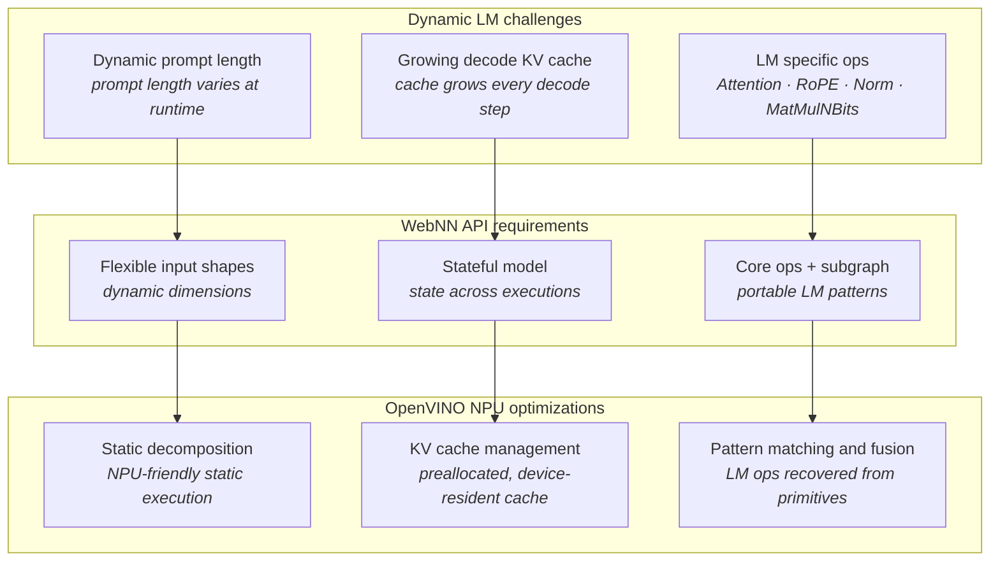

# Support Dynamic Language Models on WebNN NPU

## Authors
- [Wei Wang](mailto:wei4.wang@intel.com) (Intel)

## Participate
- [Support flexible input sizes #883](https://github.com/webmachinelearning/webnn/issues/883)
- [Composite operators / subgraphs #907](https://github.com/webmachinelearning/webnn/issues/907)

## Table of contents
1. [Introduction](#introduction)
2. [Goals](#goals)
3. [Non-goals](#non-goals)
4. [Dynamic LM challenges](#dynamic-lm-challenges)
    - [Dynamic prompt length](#dynamic-prompt-length)
    - [Growing decode KV cache](#growing-decode-kv-cache)
    - [LM specific ops](#lm-specific-ops)
5. [WebNN API requirements](#webnn-api-requirements)
    - [1. Flexible input shapes](#1-flexible-input-shapes)
    - [2. Stateful model](#2-stateful-model)
    - [3. Core ops and subgraph](#3-core-ops-and-subgraph)
    - [4. Metadata passed to the underlying implementation](#4-metadata-passed-to-the-underlying-implementation)
6. [OpenVINO NPU optimizations](#openvino-npu-optimizations)
    - [Static decomposition](#static-decomposition)
    - [KV cache management](#kv-cache-management)
    - [Pattern matching and fusion](#pattern-matching-and-fusion)
7. [Considered Alternatives](#considered-alternatives)
8. [Privacy & Security Considerations](#privacy--security-considerations)
9. [Open Questions](#open-questions)
10. [References & Acknowledgements](#references--acknowledgements)

## Introduction
WebNN today targets models whose shapes are fully resolved at [`MLGraphBuilder.build()`](https://www.w3.org/TR/webnn/#api-mlgraphbuilder-build) time and whose execution is stateless: the outputs of each [`MLContext.dispatch()`](https://www.w3.org/TR/webnn/#api-mlcontext-dispatch) depend only on the input tensors bound to that call, and nothing is carried over from one dispatch to the next. A language model (LM) violates both assumptions. First, its input shapes cannot be resolved at build time: a chat turn begins with a prompt of arbitrary length and then emits one token at a time, so the sequence length of the input is only known at dispatch. Second, its execution is not stateless: each step depends on a key/value (KV) cache that grew during every previous step, so every dispatch needs what the previous dispatches left behind.

Based on our proof of concept, this explainer describes what it takes to run an LM efficiently on an NPU through WebNN. We organize it into three technical layers:

- **Dynamic LM challenges** — what stands in the way of running a dynamic LM on WebNN as it exists today: a prompt length that is only known at runtime, a decode KV cache that grows with every step, and the LM specific operators (Attention, RoPE, Norm, MatMulNBits) that frameworks are left to emulate out of primitives.
- **WebNN API requirements** — the requirements those challenges place on the WebNN API, and what it has to add to meet them: flexible input shapes for a prompt length known only at runtime, a stateful model so the KV cache survives across executions, and core operators plus recognizable subgraph patterns so LM specific computation stays portable.
- **OpenVINO NPU optimizations** — what the underlying implementation does. Our proof of concept runs on OpenVINO on the Intel NPU, so this explainer describes only the optimizations OpenVINO provides on the NPU: static decomposition so the NPU still sees static work, KV cache management that keeps the cache preallocated and device-resident, and pattern matching that recovers LM structure from primitive operators so it can be optimized.

We keep the three layers separate on purpose. Through the WebNN API, a page only describes its model: which dimensions change at runtime, which tensors are the KV cache, and which operators it uses. It does not say how the model should be run; that is up to the underlying implementation. The OpenVINO optimizations in the third layer — static model variants, chunking, cache preallocation, pattern matching — are just one way to run it. Another underlying implementation can run it differently, and the page uses the same graph either way.



## Goals
- Run a dynamic LM end to end on an NPU through WebNN across an arbitrary prompt length and as many decode steps as the model's context length allows, **without rebuilding the graph**.

- Keep the KV cache **resident on the device** across dispatches, so the per-step cost tracks the compute the model actually does rather than the size of the cache.

- Express the operators that every modern LM contains — scaled dot-product attention, rotary position embedding, RMS normalization, and block-quantized matrix multiplication — in a **standard way**, so every underlying implementation can reliably recognize them and apply its optimized implementation, instead of each framework emitting its own decomposition.

- Keep the model **portable**: the page only describes which dimensions change and which tensors are the KV cache, and each underlying implementation chooses its own strategy. A graph written for the NPU must still run on GPU and CPU.

- Make the NPU strategy — static model variants, prefill chunking, in-place cache update, fusion — an **implementation detail** that is observable in performance but not in semantics.

## Non-goals
- **We do not define a model format, a tokenizer, or a sampling API.** Tokenization, sampling, beam search, and chat templating stay in the framework or the application. WebNN's surface ends at the graph.

- **We do not resolve shapes from tensor data.** This explainer inherits the boundary drawn in the [Dynamic Shape explainer](https://github.com/webmachinelearning/webnn/blob/main/dynamic-shape-explainer.md): shapes are derived by algebra from input shapes and build-time constants. A sequence length that depends on the *values* a model produced (for example, trimming at a stop token inside the graph) is out of scope.

- **We do not specify a cache eviction or paging policy.** Sliding windows, attention sinks, and paged attention are model- and application-level decisions. The API provides a KV cache with explicit shape and explicit update; it does not pick a policy.

- **We do not expose NPU-specific controls.** There is no API to select a model variant, a chunk length, or a fusion pattern. Those are chosen by the underlying implementation.

## Dynamic LM challenges

### Dynamic prompt length
A chat turn starts with a *prefill* pass over the whole prompt, and the prompt length is whatever the user typed. With static shapes a framework can only rebuild the graph per length, pre-build a family of graphs, or pad every prompt to a fixed maximum. This is the general flexible-input-size problem rather than an LM specific one, and it is analyzed in full — use cases, existing workarounds, and their costs — in the [Dynamic Shape explainer](https://github.com/webmachinelearning/webnn/blob/main/dynamic-shape-explainer.md). What matters here is only that an LM hits it on every single turn. Dynamic shapes remove the rebuild, but on their own they are not sufficient on an NPU: an NPU compiles a graph into a fixed schedule over a fixed memory plan, and a shape that changes on every dispatch is exactly what such a compiler cannot absorb for free.

### Growing decode KV cache
After prefill, decode emits one token per step. Each step computes keys and values for a single position and attends over every position seen so far, so the cache grows by one entry per step, per layer. For a stateless model, that cache is an input and an output of every dispatch. Three costs follow:

- **Transfer.** The compute of a single decode step is tiny; the copy is proportional to the whole conversation, so the step time grows linearly with context length for reasons that have nothing to do with the model.
- **Allocation and concatenation.** `newCache = concat(oldCache, newEntry)` allocates a fresh buffer every step and copies the old contents into it — again linear in the context, and it doubles peak memory at the moment of the copy.
- **Shape churn.** The cache length changes on every step, so an underlying implementation that specializes per shape has to re-specialize each time.

A stateless API also leaves the page no way to say *this buffer is the same buffer as last time*, which is precisely the fact an underlying implementation needs in order to keep it in device memory and update it in place.

### LM specific ops
The repeated block of a modern decoder is small and remarkably uniform across model families:

- **Attention** — scaled dot-product attention with causal masking and grouped-query key/value heads.
- **RoPE** — rotary position embedding applied to queries and keys before attention.
- **Norm** — RMS normalization (and its `layerNormalization` relative) before each sublayer.
- **MatMulNBits** — matrix multiplication against n-bit group-quantized weights, which is how a model of practical size fits in device memory at all.

WebNN does not expose these directly today, so a framework lowers each one into a chain of primitive operators. For example, MatMulNBits becomes an explicit dequantization — gather the scales and zero points, unpack the n-bit values from the packed bytes, widen them, subtract the zero points, multiply by the scales, then `matmul` on the widened weights. This lowering is lossy in three distinct ways:

- **It materializes what should never exist.** The dequantized weight matrix is many times the size of the packed one, and it is produced only to be consumed immediately. On a memory-constrained NPU this can be the difference between a model that fits and one that does not. The same applies to attention's intermediate score matrix, which is quadratic in sequence length.
- **It hides the intent.** An underlying implementation with a hand-tuned fused attention or fused dequantizing GEMM kernel now has to *recover* the pattern by matching a subgraph. Pattern matching is brittle: a transposition folded differently, an extra `reshape`, a `cast` in a different place, and the match fails silently — leaving the graph on the slow path with no diagnostic.
- **It is not portable.** Each framework lowers slightly differently, so "does this model run fast on WebNN" becomes a question about which framework emitted the graph, not about the model.

## WebNN API requirements
Each challenge above turns into a requirement on the WebNN API:

| Challenge | Requirement on WebNN | Proposed mechanism |
| --- | --- | --- |
| Dynamic prompt length | One compiled graph must accept a sequence length that is only known at dispatch | [Flexible input shapes](#1-flexible-input-shapes) |
| Growing decode KV cache | A cache must persist across executions and be updatable without crossing the API boundary | [Stateful model](#2-stateful-model) |
| LM specific ops | LM computation must be expressible at the level it is defined, so intent reaches the kernel | [Core ops and subgraph](#3-core-ops-and-subgraph) |
| All of the above, on a compile-ahead accelerator | The app must be able to tell the underlying implementation what the graph does not express | [Metadata](#4-metadata-passed-to-the-underlying-implementation) |

---

### 1. Flexible input shapes
This requirement is met by the dimension model from the [Dynamic Shape explainer](https://github.com/webmachinelearning/webnn/blob/main/dynamic-shape-explainer.md), adopted here unchanged: a dimension is either a static integer or a **named dynamic** dimension, dimensions sharing a name resolve to the same value, checks that need concrete shapes defer to dispatch, and `computeShapes()` reports concrete output shapes before the app allocates output tensors. See that document for the API surface and the design rationale.

For an LM, three named dynamic dimensions cover every shape that changes at runtime, so the same compiled graph serves both phases. `'seq_len'` is what tells the phases apart: the prompt length at prefill, 1 at decode. `'past_len'`, the length of the KV cache, is 0 at the first prefill and grows by one with every decode step. `'total_len'` is always `'past_len'` plus `'seq_len'`, so it changes on every dispatch, within decode as well as between the phases:

```js
// 'seq_len'    — tokens in this dispatch: the prompt length at prefill, 1 at decode.
// 'past_len'   — tokens already in the KV cache: 0 at the first prefill, +1 per decode step.
// 'total_len'  — past_len + seq_len: everything attention sees.
const inputIds = builder.input('input_ids',
    {dataType: 'int32', shape: [1, 'seq_len']});
const positionIds = builder.input('position_ids',
    {dataType: 'int32', shape: [1, 'seq_len']});
const attentionMask = builder.input('attention_mask',
    {dataType: 'int32', shape: [1, 'total_len']});
```

### 2. Stateful model
The second requirement is the one that dynamic shapes alone cannot provide: a value that **persists across executions of the same graph**, lives in device memory, and is updated in place. For an LM, that value is the KV cache, so throughout this explainer a *stateful* model is one that keeps its KV cache inside the model between executions. The figure below compares a stateless model with a stateful one:


A **stateless** model keeps nothing between runs. Everything a run produces is an output, and everything it needs is an input:

- **The application carries the cache.** To reach the next decode step, the KV cache leaves the model as an output, is held by the application, and comes back in as an input, so it crosses the API boundary twice on every step.
- **The cost follows the conversation, not the model.** The cache is transferred, and usually reallocated, on every step, so the overhead grows with the context length even though each decode step computes a single token.
- **The application manages the lifecycle.** It supplies the empty cache on the first run, swaps outputs into inputs between runs, and discards the cache when a conversation ends.

A **stateful** model replaces that input/output pair with internal read and write operations: `ReadValue` reads the KV cache at the start of a run, and `AssignValue` writes the updated cache at the end of it. The cache itself lives inside the model, persists between runs, and is never exposed as an input or an output:

- **The cache stays inside the model.** The underlying implementation decides where and in what form to keep it, so it can stay resident in device memory and be updated in place instead of crossing the API boundary on every step.
- **The application only passes real inputs and outputs.** It sends `input_ids` and `position_ids`, and reads back `logits`; there are no KV cache tensors to allocate, copy, or swap.
- **The cache is not visible to the application.** Since the cache is neither an input nor an output, the application cannot read its contents. This costs nothing for the KV cache, which the application never needs to look at, and it is what lets the underlying implementation keep the cache in whatever form suits the device.

WebNN can express this without new operators. The graph is built exactly as a stateless one, with the cache as an ordinary input and the updated cache as an ordinary output. The app then marks which input/output pairs carry the KV cache, and sets a flag that turns the stateful treatment on:

```webidl
dictionary MLKVCachePair {
  // Graph input that provides the KV cache to the graph.
  required DOMString input;
  // Graph output that stores the updated KV cache.
  required DOMString output;
};

dictionary MLBuildOptions {
  // When false (the default), the pairs are ignored and the graph is stateless.
  boolean useStateful = false;
  sequence<MLKVCachePair> kvCachePairs = [];
};

partial interface MLGraphBuilder {
  Promise<MLGraph> build(MLNamedOperands outputs,
                         optional MLBuildOptions options = {});
};

partial interface MLGraph {
  // True if the underlying implementation manages the KV cache pairs.
  // False if the graph was built stateless, either because useStateful
  // was false or because the underlying implementation does not support
  // stateful for this model.
  readonly attribute boolean isStateful;
  // Reset KV cache for a new conversation. Does nothing when isStateful is false.
  undefined resetKVCache();
};
```

The interfaces are:

- **`MLKVCachePair`** names one KV cache by the graph input and output that carry it. `input` provides the cache to the graph: the cache left by the previous dispatch, or an empty one before the first dispatch and after `resetKVCache()`. `output` stores the updated cache, which becomes the cache only once the current dispatch completes, so a graph can read and update the same cache in one dispatch without a read/write hazard.

- **`MLBuildOptions.useStateful`** requests a stateful graph. When it is false, the default, `kvCachePairs` is ignored and the cache inputs and outputs remain ordinary bindings that the app supplies itself. When it is true, it is a request, not a guarantee; see `isStateful`.

- **`MLBuildOptions.kvCachePairs`** lists the KV cache pairs of the graph, typically one for the keys and one for the values of each layer. It is validated by [`MLGraphBuilder.build()`](https://www.w3.org/TR/webnn/#api-mlgraphbuilder-build) as described below.

- **`MLGraph.isStateful`** reports what was actually built. It is true if the underlying implementation manages the KV cache pairs. It is false if `useStateful` was false, or if the underlying implementation does not support stateful models and the graph was built stateless instead. If it is false, the app binds the cache inputs and outputs and carries the cache between dispatches itself.

- **`MLGraph.resetKVCache()`** resets every KV cache of the graph to its initial, empty value, for a new conversation, without rebuilding the graph or reallocating device memory. It does nothing when `isStateful` is false.

No interface returns a cache's contents or shape, so the KV cache is not readable from script. This is a privacy property as much as a performance one; see [Privacy & Security Considerations](#privacy--security-considerations).

With `useStateful = true`, [`MLGraphBuilder.build()`](https://www.w3.org/TR/webnn/#api-mlgraphbuilder-build) splits the work between WebNN and the underlying implementation:

1. **WebNN validates the pairs.** Before the graph is handed to the underlying implementation, [`MLGraphBuilder.build()`](https://www.w3.org/TR/webnn/#api-mlgraphbuilder-build) checks every pair and rejects with a `TypeError` if any check fails:
   - `input` names an input of the graph, and `output` names one of the outputs passed to [`MLGraphBuilder.build()`](https://www.w3.org/TR/webnn/#api-mlgraphbuilder-build).
   - Each input and each output appears in at most one pair, so every cache has exactly one reader and one writer.
   - The input and the output have the same data type and the same rank.
   - Each dimension is either the same static size on both sides, or dynamic on both sides. For example, `past_key_0` with shape `[1, 8, 'past_len', 128]` can pair with `present_key_0` with shape `[1, 8, 'total_len', 128]`. The two dynamic dimensions do not need the same name, and for a KV cache they cannot have it: the input holds the cache before this dispatch, `'past_len'` tokens long, and the output holds it after this dispatch's tokens are appended, `'total_len'` = `'past_len'` + `'seq_len'` tokens long. The output's length becomes the input's length on the next dispatch, so `'total_len'` of one dispatch is `'past_len'` of the next. A static dimension, such as the number of heads or the head size, cannot change between dispatches, so it must match exactly.
   - `kvCachePairs` is not empty.

   These checks depend only on the graph description, so every WebNN implementation reaches the same result, whatever the underlying implementation.

2. **WebNN's backend adapts the pairs.** Passing the generic checks means the pairs are well formed; it does not mean a given underlying implementation can keep them as state. Each underlying implementation has its own requirements, so WebNN's backend for it checks the graph against those requirements as thoroughly as it can and rewrites the pairs into the form that underlying implementation expects. A failed backend check does not fail the build: it only means the backend builds the graph stateless and reports `isStateful` as false. The more the backend checks up front, the fewer stateful builds reach the underlying implementation only to fail there.

3. **The underlying implementation converts the pairs.** WebNN's backend passes the adapted graph and its pairs down, and only the underlying implementation turns each pair into internal state, the `ReadValue` and `AssignValue` of the figure. If the conversion or compilation still fails in the underlying implementation, the failure is handled like any other compilation failure: [`MLGraphBuilder.build()`](https://www.w3.org/TR/webnn/#api-mlgraphbuilder-build) rejects with an `OperationError`. How each underlying implementation handles the pairs, and the checks each backend runs, are listed in [Stateful support in underlying implementations](#stateful-support-in-underlying-implementations).

4. **The pairs leave the graph's interface.** When `isStateful` is true, the paired inputs and outputs are no longer part of the resulting `MLGraph`'s interface. [`MLContext.dispatch()`](https://www.w3.org/TR/webnn/#api-mlcontext-dispatch) neither requires nor accepts them, and binding one is a `TypeError`. The app binds only the remaining inputs and outputs, such as `input_ids` and `logits`. The pairs are removed rather than silently ignored on purpose: an ignored cache output would never be written, so an app that wrongly carried the cache itself would read stale or zero data with no error, and would keep allocating a past and a present tensor per layer, which is exactly the memory the stateful model is meant to save. Rejecting the binding exposes that mistake on the first dispatch.

The following is a simplified example of how a page builds and runs a stateful decoder. Helper functions such as `embedTokens`, `newKeysValues`, `decoderLayer`, and `lmHead` stand for ordinary WebNN graph code and are not shown.

Each layer's cache is an ordinary input and output, and the pairs are declared once, at build time:

```js
const inputIds = builder.input('input_ids',
    {dataType: 'int32', shape: [1, 'seq_len']});
const positionIds = builder.input('position_ids',
    {dataType: 'int32', shape: [1, 'seq_len']});
const kvDesc = {dataType: 'float16',
                shape: [1, numKvHeads, 'past_len', headDim]};

// Hidden states flowing through the layers: [1, 'seq_len', hiddenSize].
let hiddenStates = embedTokens(builder, inputIds);
const outputs = {};
const kvCachePairs = [];
for (let i = 0; i < numLayers; i++) {
  // Ordinary inputs: the cache as of the previous dispatch.
  const pastK = builder.input(`past_key_${i}`, kvDesc);
  const pastV = builder.input(`past_value_${i}`, kvDesc);

  // Append this dispatch's keys/values. 'total_len' = past_len + seq_len.
  const [k, v] = newKeysValues(builder, hiddenStates, positionIds, i);
  const presentK = builder.concat([pastK, k], 2);
  const presentV = builder.concat([pastV, v], 2);

  // Attention over the whole cache, with a causal mask derived from
  // positionIds, then the feed-forward block.
  hiddenStates = decoderLayer(builder, hiddenStates, presentK, presentV,
                              positionIds, i);

  // Ordinary outputs: the cache for the next dispatch.
  outputs[`present_key_${i}`] = presentK;
  outputs[`present_value_${i}`] = presentV;
  kvCachePairs.push({input: `past_key_${i}`, output: `present_key_${i}`},
                    {input: `past_value_${i}`, output: `present_value_${i}`});
}
outputs.logits = lmHead(builder, hiddenStates);

const graph = await builder.build(outputs, {useStateful: true, kvCachePairs});
if (!graph.isStateful) {
  // The graph was built stateless: bind past_* and present_* in
  // dispatch() and carry the cache between steps in the app.
}
```

When `isStateful` is true, each dispatch then binds only the real inputs and outputs:

```js
// Prefill: the whole prompt in one dispatch.
context.dispatch(graph,
    {input_ids: promptIds, position_ids: promptPos},
    {logits: promptLogits});

// Decode: one token per dispatch; the cache stays inside the model.
while (!done) {
  context.dispatch(graph,
      {input_ids: tokenId, position_ids: tokenPos},
      {logits: stepLogits});
  // ... read stepLogits and sample the next token; set done at the end
  // token or the length limit; otherwise write the token into tokenId
  // and its position into tokenPos for the next step ...
}

// A new conversation starts from an empty cache.
graph.resetKVCache();
```

Exported LMs already have these input/output pairs, such as `past_key_values.*` and `present.*` in an ONNX model, so a converter only needs to list the pairs; it does not have to change the graph. The page's dispatch code also gets simpler: it no longer passes cache tensors to [`MLContext.dispatch()`](https://www.w3.org/TR/webnn/#api-mlcontext-dispatch), allocates a new cache every step, or swaps input and output buffers between steps.

#### Stateful support in underlying implementations
Underlying implementations differ in whether they support stateful models, in how WebNN's backend for each has to express the pairs, and in the constraints they put on the state. The notes below cover the underlying implementations that WebNN builds on today. They are informative, not normative, and support changes from release to release.

- **Core ML.** Starting with iOS 18 and macOS 15, a Core ML model can declare *state* inputs. Inside the ML program, a state is read with `read_state` and written with `coreml_update_state`, and Core ML keeps it in an `MLState` object that is created once with `makeState()` and passed to every prediction. WebNN's Core ML backend can express each pair as one state. The constraint is shape: a state has a fixed shape, and in practice combining states with flexible input shapes is not reliable. The cache therefore has to be allocated at a fixed capacity, which the [metadata](#4-metadata-passed-to-the-underlying-implementation) `max-prompt-length` and `min-response-length` can size. The attention mask then marks how much of that capacity holds valid tokens. A varying `'seq_len'` may also need separate fixed-shape variants of the model. So WebNN's Core ML backend checks the OS version, and checks that it can fix a capacity for every cache, for example from the metadata. If either check fails, or it cannot serve the varying `'seq_len'` with fixed-shape variants, it builds the graph stateless and `isStateful` is false.

- **LiteRT.** LiteRT represents state as resource variables, through the builtin `VAR_HANDLE`, `READ_VARIABLE`, and `ASSIGN_VARIABLE` operators. WebNN's LiteRT backend can rewrite each pair into a variable that is read at the start of the graph and assigned at its end. The built-in CPU kernels support these operators, and the XNNPACK delegate supports them only when it is created with the `TFLITE_XNNPACK_DELEGATE_FLAG_VARIABLE_OPERATORS` flag, in which case XNNPACK keeps the variables internally. Support in GPU and NPU delegates is not documented. Where a delegate does not take the variable operators, they fall back to the CPU and the graph is partitioned around them, which can cost more than the state saves. WebNN's LiteRT backend therefore checks whether the selected delegate supports the variable operators, and if it does not, builds the graph stateless and reports `isStateful` as false.

- **ONNX Runtime.** The ONNX format has no notion of state, so whether a pair can become state depends on the execution provider (EP). The EPs below are examples, not a complete list:
  - **OpenVINO EP.** With the `enable_causallm` provider option, the EP converts the model to a stateful one with OpenVINO's `MakeStateful` transformation, so the cache becomes `ReadValue`/`Assign` state and, on the NPU, is managed by [NPUW](#npuw) as described in [KV cache management](#kv-cache-management). The EP does not receive the pairs explicitly. It finds them by naming convention, matching an output named like `present_key_0` and pairing it with the corresponding `past_key_0` input. WebNN's ONNX Runtime backend therefore has to make sure that, when `useStateful` is true, the model it generates meets this naming requirement; otherwise [`MLGraphBuilder.build()`](https://www.w3.org/TR/webnn/#api-mlgraphbuilder-build) fails.
  - **WebGPU EP and CPU EP.** These EPs have no state support, so WebNN's ONNX Runtime backend builds the graph stateless, `isStateful` is false, and the app carries the cache.

The same pair declaration thus reaches each underlying implementation in a different form, as states, variables, or a naming convention, and only WebNN's backend for that underlying implementation can tell whether the result is stateful. That is why `isStateful` is reported by the built graph rather than implied by `useStateful`.

### 3. Core ops and subgraph
The third requirement is about expressing LM computation at a level where its intent survives from the model to the kernel. Today this relies on **implicit pattern matching**. WebNN has no built-in operator for attention, RoPE, or MatMulNBits, so:

1. The framework decomposes each high-level operation into primitive WebNN operators, choosing the specific decomposition it knows the underlying implementation can recognize.
2. The underlying implementation scans the graph, matches that subgraph, and fuses it back into a single optimized kernel.

This can reach good performance, but only when the framework and the underlying implementation agree on the pattern — and nothing in the API makes them agree:

- **Patterns differ across underlying implementations.** Each underlying implementation recognizes its own form of a pattern: one expects the `transpose` before the `matmul` and another after it, one requires a `cast` in a specific position and another folds it away, one matches RoPE as slice/negate/concat and another as a gather of interleaved pairs.
- **Mismatches fail silently.** A decomposition tuned for one underlying implementation can miss the match on another and fall back to the slow path with no diagnostic.
- **The result is neither compatible nor portable.** A framework either targets one underlying implementation's patterns or maintains a separate lowering per underlying implementation, while the page cannot even tell which underlying implementation it is running on.

**Subgraphs** address this by making the pattern explicit and standard. Instead of each underlying implementation deciding which decomposition it recognizes, a subgraph defines a standard composition of core operators that the page invokes as a single unit. Every underlying implementation can execute it correctly through its decomposition, and an underlying implementation with a fused kernel for it can use that kernel directly, without recovering the pattern from the surrounding graph. A framework then emits the same subgraph on every underlying implementation, so compatibility becomes a property of the standard rather than of the framework's knowledge of each underlying implementation.

The design is still under discussion in the WebNN Working Group; see [Composite operators / subgraphs (webmachinelearning/webnn#907)](https://github.com/webmachinelearning/webnn/issues/907) for the proposal and its open questions.

### 4. Metadata passed to the underlying implementation
The first three requirements describe the *computation*. They do not describe how the app intends to *use* it — and on a compile-ahead accelerator that intent is exactly what the underlying implementation needs in order to choose a strategy. A graph with a `'seq_len'` dimension says the length varies; it does not say that the app will run one 2k-token prefill followed by hundreds of single-token decodes, or that the conversation will never exceed 4k tokens. Today the underlying implementation has to guess at that from the shapes it happens to observe, and it guesses after the cost has already been paid.

So the fourth requirement is a channel for the web app to pass **metadata** through WebNN to the underlying implementation. It is supplied once, at build time, because that is when an underlying implementation for a compile-ahead accelerator makes its decisions:

```webidl
typedef (DOMString or double or boolean) MLMetadataValue;

// Build-time metadata: describes the model and how it will be driven.
// MLBuildOptions is the dictionary introduced in the Stateful model section.
partial dictionary MLBuildOptions {
  record<DOMString, MLMetadataValue> metadata;
};
```

```js
const graph = await builder.build({logits}, {
  metadata: {
    'max-prompt-length': 2048,   // longest prompt the app will prefill (NPUW_LLM_MAX_PROMPT_LEN)
    'min-response-length': 256,  // tokens reserved for the reply (NPUW_LLM_MIN_RESPONSE_LEN)
  },
});
```

There is deliberately no dispatch-time metadata. Every dispatch already carries concrete input shapes, and those identify the phase: a `'seq_len'` greater than 1 is a prefill, a `'seq_len'` of 1 is a decode, and the underlying implementation selects the matching compiled variant from that alone. A per-dispatch `phase` hint would mostly repeat what the shapes say, and would raise questions the API is better off without — which one wins when the hint contradicts the shape, and whether a changing hint may trigger a strategy switch or a recompilation mid-conversation. Cases the shapes cannot distinguish are listed in [Open Questions](#open-questions).

The design rules that keep this from becoming a backdoor:

- **Metadata is a hint, never a semantic.** An underlying implementation that ignores every key must produce the same results as one that uses all of them. Metadata may change *how fast* a graph runs and *how much memory* it takes; it must never change *what it computes*. This is what lets the same page run on an underlying implementation that has never heard of a given key.

- **Keys are registered, not arbitrary.** A page cannot pass any field it likes. Only keys defined alongside the API are valid, and each one is registered with its name and the type of its value; the value itself is the app's. A key is registered only if it is meaningful to every underlying implementation, so there are no vendor-specific keys. The value of metadata is that one app annotation helps every underlying implementation. The two keys defined here, `max-prompt-length` and `min-response-length`, are general LM concepts: how long a prompt the app can submit, and how many tokens it reserves for the reply. Neither depends on the device. Each underlying implementation maps them onto its own configuration: [NPUW](#npuw) used by our proof of concept turns `max-prompt-length` into `NPUW_LLM_MAX_PROMPT_LEN` and `min-response-length` into `NPUW_LLM_MIN_RESPONSE_LEN`, while another underlying implementation might turn the same keys into a static-shape bound and a cache reservation. How many options an underlying implementation has, and what they are called, stays inside the underlying implementation. An underlying implementation may ignore a registered key it has no use for, but must not fail because of it. New keys are added the same way operators are, through the Working Group.

- **Metadata describes the app's intent, not the device's configuration.** `'max-prompt-length': 2048` states a property of the workload; there is deliberately no `'npu-tile-size'` or `'use-fused-attention'`. The former lets any underlying implementation act on it; the latter would be the NPU-specific control that [Non-goals](#non-goals) rules out, and would turn a portable page into one tuned for a single device.

- **Metadata is not a side channel.** Values travel from the page into the underlying implementation only. Nothing is reflected back, so metadata adds no new way to learn about the device, and a page learns nothing from supplying a key that the underlying implementation ignored.

This matters most for the compile-time choices in [Static decomposition](#static-decomposition): with `max-prompt-length` and `min-response-length`, the underlying implementation sizes its static models (the maximum prompt and the set of generate variants) and its KV cache allocation from what the app actually intends, instead of falling back to fixed defaults that may be too small for the conversation or waste memory on a context it never reaches. An app that supplies no metadata still runs correctly, just with the underlying implementation's defaults.

## OpenVINO NPU optimizations
This section describes how our proof of concept runs the graph on an Intel NPU. The WebNN graph is converted to an OpenVINO model and compiled by the NPU plugin through <a id="npuw"></a>**NPUW** (NPU Wrapper), the plugin's execution path for LMs. The optimizations described below are invisible to the page except through performance: they never change what the graph computes. A page builds the graph as described in [WebNN API requirements](#webnn-api-requirements), and [NPUW](#npuw) applies these optimizations underneath.

The framing: an NPU is a compile-ahead accelerator. It reaches peak efficiency when the schedule, the tiling, and the memory plan are all fixed before execution. [NPUW](#npuw) never compiles a dynamic graph. It compiles a small, fixed set of static models up front and turns every source of dynamism — the prompt length, the growing cache, the current position in the conversation — into padding, masking, and host-side bookkeeping.

### Static decomposition
[NPUW](#npuw) splits the LM into separately compiled static models:

- **One prefill model, optionally run in chunks.** The prompt is processed by a single static prefill model. `NPUW_LLM_MAX_PROMPT_LEN` (default 1024, rounded up to a multiple of 64) sets the longest prompt it accepts; a longer prompt fails with an error asking for a larger value. The prefill model can be compiled for one chunk of `NPUW_LLM_PREFILL_CHUNK_SIZE` tokens (default 1024, must be a power of two) instead of the whole prompt. The prompt then runs as a loop over that model, the last chunk only partly filled, and each chunk's keys and values are written into the prefill model's past-KV input so later chunks attend to earlier ones. Chunking only takes effect when the chunk size is smaller than the maximum prompt length, in which case the maximum is rounded up to a multiple of the chunk size. With the defaults both are 1024, so out of the box the prompt is processed in a single 1024-token pass.

- **Generate models at fixed KV capacities.** Decode runs on separate generate models that take one token per step. The total context is `NPUW_LLM_MAX_PROMPT_LEN` plus `NPUW_LLM_MIN_RESPONSE_LEN` (default 128, rounded up to a multiple of 64). By default, [NPUW](#npuw) compiles one generate model per KV capacity of 1024, 2048, 4096, … tokens plus the minimum response length, for as long as that fits within the total context, and adds the total context itself as the largest one. With the defaults this is a single model with a capacity of 1152; a maximum prompt length of 8192 yields four, with capacities 1152, 2176, 4224, and 8320. After prefill, [NPUW](#npuw) picks the smallest variant that holds the prompt plus the minimum response length, and during decode it moves to the next larger one when the current one fills (see [KV cache management](#kv-cache-management)). All variants are compiled up front, so nothing is compiled at runtime.

- **A shared LM head.** By default, the final vocabulary projection is cut out into a third model that prefill and generate share. The prefill output is sliced to the last position before it reaches the head, so the large vocabulary projection never runs over the padded prompt.

- **Shared weights and folded layers.** The prefill model, the generate variants, and the LM head all register their weights in one shared weights bank, so each weight is stored once however many models use it. By default, [NPUW](#npuw) also identifies the repeated transformer block, compiles it once as a function, and calls it for every layer with that layer's weights. Together these keep the compile time and the memory footprint of several static models manageable.

- **Padding and masking.** A prompt shorter than the compiled length is right-aligned in the static input tensors: its tokens are copied to the end of `input_ids`, the caller's `attention_mask` is copied to the end of the mask, `position_ids` are padded to match, and the leading unused positions keep a mask of zero, so they are excluded from attention. When the prefill result is handed to the generate model, only the rows that hold real tokens are copied into its cache, so padding never reaches the decode phase or the outputs the page reads.

The context a conversation can reach is fixed at compile time, by `NPUW_LLM_MAX_PROMPT_LEN` plus `NPUW_LLM_MIN_RESPONSE_LEN` (1024 + 128 by default). These are exactly the values the app knows, but WebNN today offers no way to pass them down to the underlying implementation. This is where the build-time [metadata](#4-metadata-passed-to-the-underlying-implementation) comes in: `max-prompt-length` and `min-response-length` map directly onto these two options. [NPUW](#npuw)'s other options, such as the prefill chunk size, are settings specific to [NPUW](#npuw) with no portable meaning across underlying implementations, so they have no metadata key and stay at [NPUW](#npuw)'s defaults; see [`npuw_option_defs.inc`](https://github.com/openvinotoolkit/openvino/blob/master/src/plugins/intel_npu/src/al/include/intel_npu/config/npuw_option_defs.inc) for the full list.

### KV cache management
OpenVINO expresses a stateful model with `ReadValue`/`Assign`. The NPU driver, however, has no native support for model state, so [NPUW](#npuw) first converts the model to a stateless one (`StatefulToStateless`) and manages the KV cache itself. This conversion is internal: to the layers above, the model still behaves as a stateful one, and they never handle the KV cache themselves. Underneath, [NPUW](#npuw) manages it as follows:

- **Preallocated by capacity.** For every layer, each generate model has a past-key and a past-value input whose sequence dimension is fixed at the variant's full capacity, laid out as `[batch, kvHeads, capacity, headDim]`. These tensors are allocated once, when the inference request is created — in NPU memory when every part of the generate model runs on the NPU, in CPU memory otherwise — and are never resized. Smaller variants are views onto the largest variant's buffer, so the cache costs the memory of the largest variant only. The number of valid tokens is a host-side counter (`num_stored_tokens`) and never reaches the NPU as a scalar. Instead, before each step [NPUW](#npuw) builds a full-capacity `attention_mask` — ones for the stored positions on the left, a one for the current token at the right end, zeros in between — and passes the real `position_ids`. Under the default generate attention hint (`STATIC`), attention is computed over the whole capacity and the mask removes the unused slots, so the cost of a step follows the size of the variant rather than the length of the conversation; the set of variants keeps that overhead bounded. When the counter reaches the current variant's capacity, the next step switches to a larger variant; if there is none, the step fails with a "KV-Cache is full" error.

- **Per-token append on the host.** In the original graph, each layer concatenates its past keys and values with the new ones and returns the concatenated result as the present output, which would mean producing the whole cache on every step. [NPUW](#npuw) rewrites the graph (`RedirectNewKvToOutput`) so that the present output is taken directly from the new token's keys and values, `[batch, kvHeads, 1, headDim]`, instead of from the concatenation. The concatenation itself stays in the graph, because attention still needs the full history plus the new token. After each step, the host copies that slice into the past input at the next free position along the sequence axis (`update_kvcache_for`), for the key and the value of every layer, and then increments the counter. Each step therefore moves one token's worth of K/V per layer regardless of how long the conversation is, which avoids copying the whole cache on every step.

- **Hidden from the caller.** The cache tensors belong to [NPUW](#npuw)'s internal inference requests and are never exposed as inputs or outputs of the model that the layers above see; to them, the cache is simply the model's state. On a decode step the caller passes only `input_ids`, `position_ids`, and `attention_mask`, and never has to handle the KV cache.

- **Reset is cheap, but history is re-prefilled.** Starting a new conversation resets the counter and zero-fills the prefill buffers; nothing is reallocated or recompiled. By default, however, every prefill is treated as the start of a new conversation. A new chat turn, whose user message spans several tokens, goes through the prefill path, and that discards the cache built up by the previous turns. The caller must therefore resubmit the entire history — every earlier question and answer plus the new message — and [NPUW](#npuw) prefills all of it again from scratch. The cost grows with the conversation: each turn recomputes everything before it, the time to the first token rises turn by turn, and the whole history has to fit within `NPUW_LLM_MAX_PROMPT_LEN`. Two options avoid this, and both are off by default: `NPUW_LLM_ENABLE_CONTINUOUS_PREFILL` keeps the existing cache and prefills only the new tokens, and `NPUW_LLM_ENABLE_PREFIX_CACHING` caches the KV of previously computed prefixes and reuses it when a prompt starts with one.

This is the underlying implementation's view of why the stateful model matters. Because the page declares the cache through KV cache pairs rather than passing it through [`MLContext.dispatch()`](https://www.w3.org/TR/webnn/#api-mlcontext-dispatch), the underlying implementation is free to keep it resident, preallocate it, and append to it — none of which it could do for an ordinary input and output.

### Pattern matching and fusion
[NPUW](#npuw) receives a graph of primitive operators and recovers the LM structure by **pattern matching**. It has matchers for attention (SDPA, including decomposed and quantized forms), RMSNorm, dequantizing MatMuls, grouped-query attention, and the RoPE sin/cos computation. It then optimizes the graph around what they find. Each optimization below applies only when the graph contains the form its matcher expects; a graph that expresses the same computation differently still runs correctly, just without that optimization.

- **Attention.** When attention is recognized, [NPUW](#npuw) decomposes SDPA itself and applies its attention strategies to it. Prefill uses the `PYRAMID` attention hint, which compiles the attention subgraph at several context lengths and picks the smallest that fits; generate uses `STATIC`. A flash-attention-style mode exists for prefill: `HFA` (Host Flash Attention) loops over K/V tiles while carrying the running softmax state, so the full score matrix is never materialized. It is selected automatically only when the NPU reports support for it and `NPUW_LLM_MAX_PROMPT_LEN` is at least 4096.

- **RoPE.** By default, a recognized sin/cos generation inside the graph is replaced by precomputed cos/sin tables. RoPE is not fused into the query/key projection.

- **RMSNorm.** The NPU compiler can recognize a decomposed RMSNorm chain, and [NPUW](#npuw) takes care to keep that chain in the form the compiler expects. Part of it is computed at higher precision by default.

- **Quantized weights.** OpenVINO has no MatMulNBits operator; an int4 weight appears as `Constant(u4) → Convert → Subtract → Multiply → MatMul`. How that chain runs depends on the configuration and on the chain being recognized. With `NPUW_DQ`, [NPUW](#npuw) rewrites a matched chain so the low-precision weight feeds the MatMul directly and the scale is applied afterwards, splitting group-quantized weights into per-group MatMuls. Without compiler-side dynamic quantization, DCOFF (decompression cut-off) instead converts the weights to fp16 on the host before execution. On devices that support it, the compiler's own dynamic quantization takes over. Models for the NPU are expected to be exported with symmetric INT4 or NF4 weights, channel-wise or with a group size of 128.

Every one of these optimizations depends on finding a pattern in a graph that was built from primitives. That is the situation described in [Core ops and subgraph](#3-core-ops-and-subgraph): each matcher targets specific graph forms, so a framework that lowers the same computation differently can miss them, and nothing reports that a match was missed — the graph simply runs on the slower path. A standard subgraph definition would not remove the need to recognize the pattern, but it would fix what has to be recognized: frameworks would emit one documented form, and each underlying implementation would match that form instead of guessing at every possible lowering.

## Considered Alternatives

### Pass the KV cache as ordinary graph inputs and outputs, without pairs
This is what frameworks do today, and it needs no new API: the cache is an input, the updated cache is an output, and the app swaps them between steps. It is also what an app does when `isStateful` is false.

We rejected it as the only option because the API cannot say that the output cache is the input cache plus this dispatch's tokens. Without that, the underlying implementation has to treat them as separate buffers, so it allocates or copies the whole cache every step, and it cannot keep the cache on the device and update it in place. The KV cache pairs add exactly this missing fact without changing the graph.

### Dedicated state operators (`readState` / `assignState`)
A graph could instead read and write named states through two new operators, the way `ReadValue` and `Assign` work in some runtimes. This is functionally equivalent to the KV cache pairs and needs the same semantics: read at the start, write once at the end, reset, and contents hidden from script. We prefer the pairs because they add no operators, and because models are already exported with the cache as input/output pairs. With state operators, every converter would have to rewrite those inputs and outputs into operator calls. With the pairs, it only declares them, and the same graph still runs stateless when `useStateful` is false or when the underlying implementation has no state support.

### Pair caches by naming convention instead of declaring them
WebNN could skip `kvCachePairs` and recognize the cache from the names of the graph's inputs and outputs, the way the OpenVINO EP of ONNX Runtime matches `past_key_*` with `present_key_*`. We rejected it because it would turn one underlying implementation's convention into a requirement on every page: a graph would be stateful or stateless depending on how its inputs happen to be named, and conventions differ between underlying implementations. With explicit pairs, the page states the relationship once, and WebNN's backend for each underlying implementation translates it into whatever form that implementation expects, including a naming convention where one is needed.

### Emulate state in WebNN when the underlying implementation has none
WebNN could keep the cache tensors itself and rebind them on every dispatch, so that `useStateful: true` always yields a stateful graph and `isStateful` would not be needed. We rejected it for now to keep WebNN thin: the emulation would add a generic state layer to every WebNN implementation, and it would still copy or double-buffer the cache on the device, so it would hide a performance difference rather than remove it. Instead, only the underlying implementation provides state, and `isStateful` tells the app when it has to carry the cache itself.

### Free-form or vendor-specific metadata keys
Metadata could accept any key, so that a page could pass, for example, NPUW options directly. We rejected it because such keys are meaningful to one underlying implementation only, would tie a page to a single device, and would grow into an unbounded configuration surface. Only registered keys that are meaningful to every underlying implementation, such as `max-prompt-length` and `min-response-length`, are accepted, and each underlying implementation maps them onto its own configuration.

## Privacy & Security Considerations
The privacy and security implications of flexible input shapes are analyzed in the [Dynamic Shape explainer](https://github.com/webmachinelearning/webnn/blob/main/dynamic-shape-explainer.md), and this explainer inherits that analysis. Those of subgraphs are still under discussion together with their design in the WebNN Working Group; see [webmachinelearning/webnn#907](https://github.com/webmachinelearning/webnn/issues/907). This section covers what the stateful model and metadata add.

### Stateful model
- **The KV cache must not leak across origins or contexts.** A cache belongs to one `MLGraph` in one `MLContext` and is destroyed with it. It is never shared between graphs, even graphs built from identical descriptions, and never survives a context teardown. A KV cache is a representation of the user's conversation, so this is a cross-origin data boundary, not only a lifetime question.

- **The KV cache must be initialized, never recycled.** Cache memory is zero-initialized on allocation and on `resetKVCache()`. A new allocation must never expose a previous allocation's contents — the ordinary uninitialized-memory requirement, applied to a buffer that may hold the previous turn of a conversation.

- **The KV cache is not readable.** No API returns a cache's contents or shape, so a compromised renderer gains no new read primitive.

- **The service must stay safe on any graph a compromised renderer builds.** The pair validation in [Stateful model](#2-stateful-model) runs again in the service, not only in the renderer: every pair names an existing input and output, no input or output appears in two pairs, and each pair agrees in data type, rank, and static dimensions. The checks and rewrites of WebNN's backend also run in the service. Dispatch-time shape inference then validates concrete cache shapes against the cache's allocated capacity before any kernel runs, so an overlong sequence fails cleanly rather than writing past the allocation.

- **Unbounded cache growth is bounded by allocation, not by trust.** A graph that grows a cache every dispatch would otherwise be an out-of-memory vector. The underlying implementation allocates a fixed capacity, for example sized from `max-prompt-length` and `min-response-length`, and fails the dispatch that would exceed it, rather than growing on demand.

- **`isStateful` and build failures reveal little about the device.** `isStateful` tells a page whether the underlying implementation supports stateful models, and a stateful build that fails in the underlying implementation rejects. Both are coarse, one-bit signals about the underlying implementation, and the same difference is already observable through the cost of a decode step. Implementations should not make `isStateful` depend on anything finer than the underlying implementation and its version.

### Metadata
- **Metadata flows one way.** Metadata travels from the page into the underlying implementation only. Nothing is reflected back, and only registered keys are accepted, so a page cannot use metadata to probe for vendor-specific behavior. A page could still vary the metadata and time the result, but metadata only changes performance, so this reveals no more than timing the graph with different shapes already does.

## Open Questions
- **How are KV cache capacities negotiated?** The current sketch lets the underlying implementation size the cache, for example from `max-prompt-length` and `min-response-length`. Should `MLKVCachePair` instead carry an explicit maximum, so a page can state the context length it intends to support and get a clean failure at build time instead of at some later dispatch? This overlaps with bounded (min/max) dimensions, listed as a future consideration in the [Dynamic Shape explainer](https://github.com/webmachinelearning/webnn/blob/main/dynamic-shape-explainer.md).

- **What if the underlying implementation clears the cache on every prefill?** In WebNN, the cache should be kept until `resetKVCache()`, so in a multi-turn chat the app only submits the new message, and the earlier turns are already in the cache. [NPUW](#npuw), by default, clears the cache on every prefill (see [KV cache management](#kv-cache-management)), so the model would forget the earlier turns. Should WebNN's backend turn on continuous prefill where it exists, and build stateless where it does not? Or should WebNN allow a prefill to start a new conversation, so that the app resubmits the whole history every turn?

- **Should an app be able to require a stateful graph?** Today `useStateful: true` is a request, and the app learns the result from `isStateful`. Some apps may prefer a build that rejects when state is unavailable, rather than a stateless graph they then have to drive differently.

- **What exactly is the normative subgraph set?** [Core ops and subgraph](#3-core-ops-and-subgraph) argues for standard subgraphs for attention, RoPE, normalization, and block-quantized matrix multiplication, but does not define them. The set needs to be written down, with a conformance statement that separates "must execute correctly" from "may fuse"; see [webmachinelearning/webnn#907](https://github.com/webmachinelearning/webnn/issues/907).

- **Is dispatch-time metadata ever needed?** Metadata is build-time only, on the assumption that input shapes identify the phase of each dispatch. That holds for ordinary prefill and decode, but not everywhere: speculative decoding verifies *k* draft tokens with a `'seq_len'` of *k*, which looks like a prefill but belongs to the decode phase and has decode's latency profile. If cases like this turn out to matter in practice, a per-dispatch hint may be worth adding — with a rule for what happens when it contradicts the shapes.

## References & Acknowledgements
- [Web Neural Network API specification](https://www.w3.org/TR/webnn/)
- [Dynamic Shape Explainer](https://github.com/webmachinelearning/webnn/blob/main/dynamic-shape-explainer.md)
- [Support flexible input sizes (webmachinelearning/webnn#883)](https://github.com/webmachinelearning/webnn/issues/883)
- [Composite operators / subgraphs (webmachinelearning/webnn#907)](https://github.com/webmachinelearning/webnn/issues/907)
- [NPUW configuration options (`npuw_option_defs.inc`)](https://github.com/openvinotoolkit/openvino/blob/master/src/plugins/intel_npu/src/al/include/intel_npu/config/npuw_option_defs.inc)
- [ONNX Runtime OpenVINO EP stateful conversion (`ov_stateful_patch_utils.cc`)](https://github.com/microsoft/onnxruntime/blob/main/onnxruntime/core/providers/openvino/ov_stateful_patch_utils.cc)
- [Core ML Tools — Stateful Models](https://apple.github.io/coremltools/docs-guides/source/stateful-models.html)
- [LiteRT resource variables (`VAR_HANDLE`, `READ_VARIABLE`, `ASSIGN_VARIABLE`)](https://github.com/tensorflow/tflite-micro/blob/main/tensorflow/lite/micro/docs/resource_variables.md)